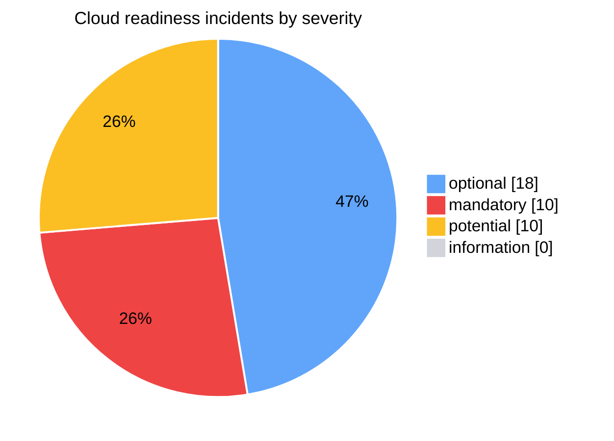
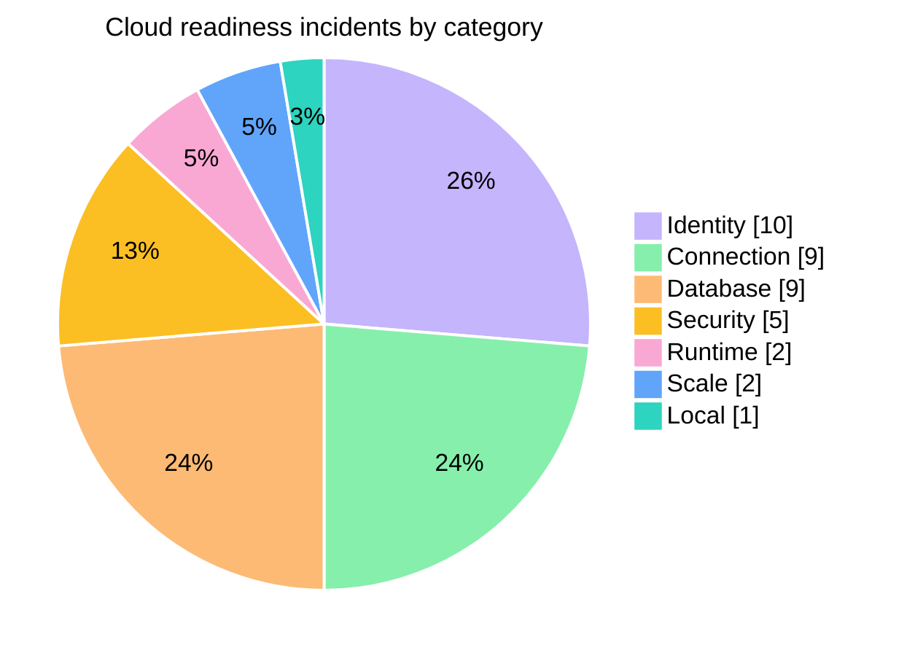
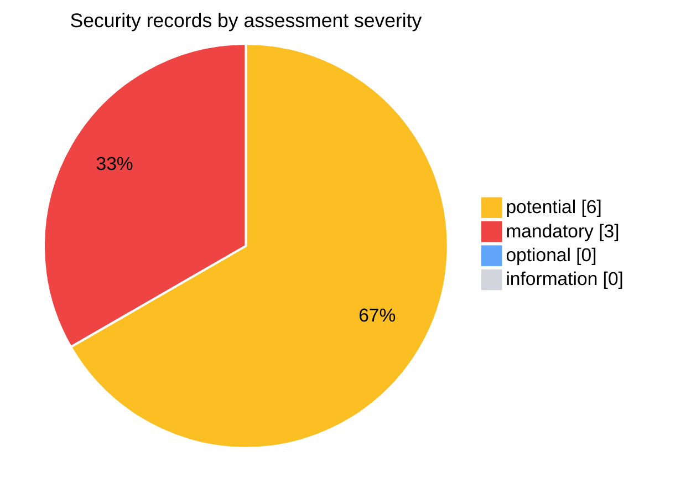
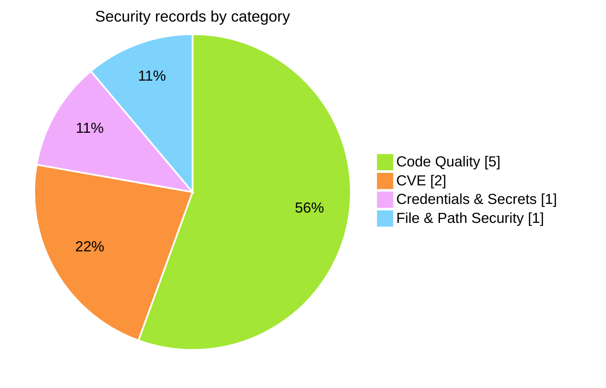
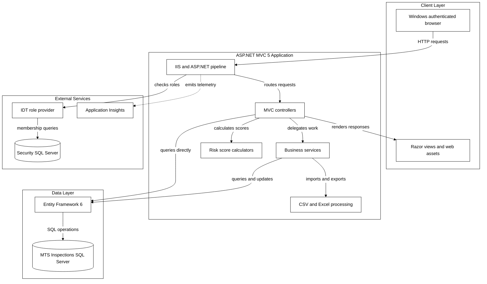
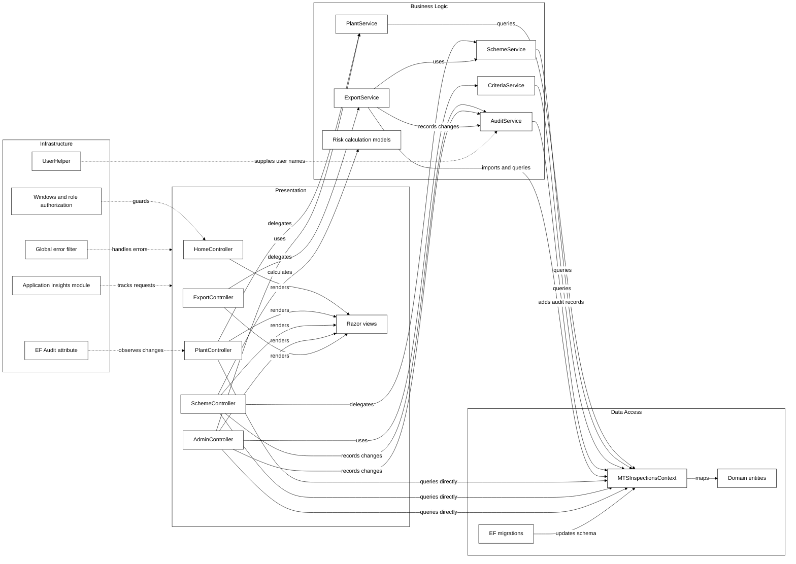
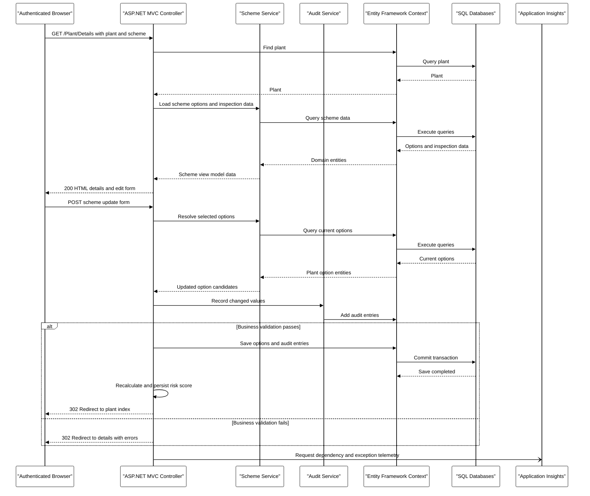
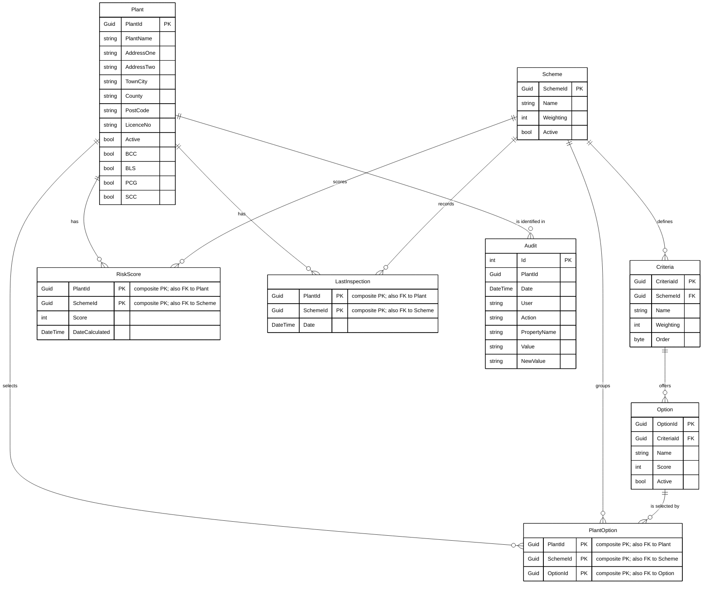
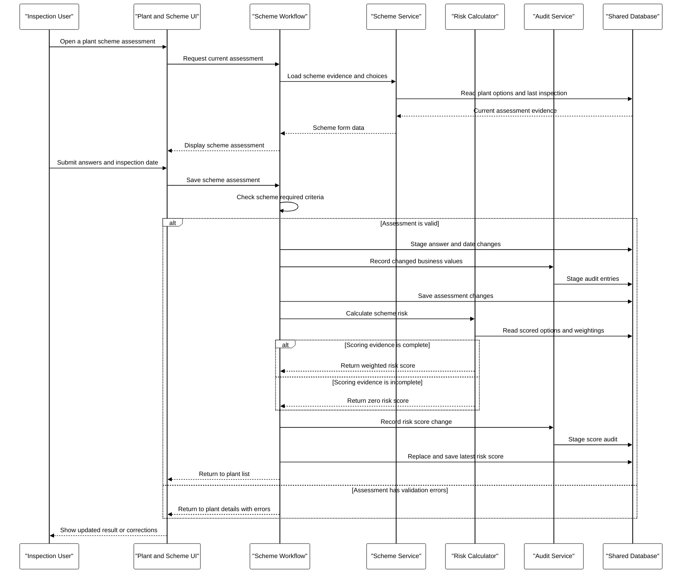

# Report_20261006113251 — Combined Cloud Readiness and Security Assessment

This document merges two historical GitHub Copilot App Modernisation assessments of the `rpa-mts-inspections` solution into one readable report. It is an export of the stored assessment artifacts, **not a fresh scan**; no assessment was re-run and the application code was not changed.

- **Security and cloud-readiness findings** come from `.github/modernize/assessment/reports/report-20261006113251/` (`report.json`, `solution.json`), run 2026-10-06T09:32:51.502Z to 2026-10-06T09:36:17.015Z (UTC) in `issue-only` mode across all eight Azure targets.
- **Supporting analysis and diagrams** come from `.github/modernize/assessment/reports/report-20261006105034/facts/`, produced by the earlier full-mode cloud-readiness run (2026-10-06T08:50:35.013Z to 2026-10-06T08:55:21.205Z UTC, Azure Container Apps target only). Its cloud-readiness incidents match the later run; the differences are listed in [Source Notes and Discrepancies](#source-notes-and-discrepancies).

## Contents

- [1. Assessment Metadata](#1-assessment-metadata)
- [2. Assessment Summary](#2-assessment-summary)
- [3. Cloud Readiness Findings](#3-cloud-readiness-findings)
- [4. Security Findings](#4-security-findings)
- [5. Migration Solution Mapping](#5-migration-solution-mapping)
- [6. Supporting Analysis and Original Diagrams](#6-supporting-analysis-and-original-diagrams)
- [Source Notes and Discrepancies](#source-notes-and-discrepancies)

## 1. Assessment Metadata

**Primary source — security and cloud-readiness run**

- **Report:** Report_20261006113251 (ID `20261006113251`); source folder `.github/modernize/assessment/reports/report-20261006113251/`
- **Format / producer:** schema version 1.0.0; .NET AppCAT CLI
- **Status / mode:** completed / `issue-only`
- **Analysis window (UTC):** 2026-10-06T09:32:51.502Z → 2026-10-06T09:36:17.015Z
- **Privacy mode:** Protected ([privacy mode help](https://aka.ms/appmod-privacy-mode))
- **Targets:** Azure App Service, Azure Kubernetes Service, Azure Container Apps, Azure App Service Container, Azure App Service Managed Instance — IDs `AppService.Windows`, `AppService.Linux`, `AKS.Windows`, `AKS.Linux`, `ACA`, `AppServiceContainer.Linux`, `AppServiceContainer.Windows`, `AppServiceManagedInstance.Windows`
- **Domains:** `security`, `cloud-readiness`
- **CVE scan:** minimum severity `high`; scope `direct`
- **Capabilities:** None specified; **operating systems:** None specified

**Supporting source — full cloud-readiness run (supplies supporting analysis)**

- **Report:** Report_20261006105034 (ID `20261006105034`); source folder `.github/modernize/assessment/reports/report-20261006105034/`
- **Format / producer:** schema version 1.0.0; .NET AppCAT CLI
- **Status / mode:** completed / `full`
- **Analysis window (UTC):** 2026-10-06T08:50:35.013Z → 2026-10-06T08:55:21.205Z
- **Privacy mode:** Protected ([privacy mode help](https://aka.ms/appmod-privacy-mode))
- **Targets:** Azure Container Apps — IDs `ACA`
- **Domains:** `cloud-readiness`
- **CVE scan:** minimum severity `high`; scope `direct`
- **Capabilities:** None specified; **operating systems:** None specified

## 2. Assessment Summary

Cloud-readiness and security totals are reported separately and are not added together. Values come from `report-20261006113251/report.json`; cloud-readiness severity counts use the source's rule-level severity.

| Group | Metric | Value |
|---|---|--:|
| Cloud readiness — totals | Projects | 2 |
| Cloud readiness — totals | Distinct rule types (source `totalIssues`) | 7 |
| Cloud readiness — totals | Incidents | 38 |
| Cloud readiness — totals | Effort (story points) | 112 |
| Cloud readiness — incidents by severity | mandatory | 10 |
| Cloud readiness — incidents by severity | potential | 10 |
| Cloud readiness — incidents by severity | optional | 18 |
| Cloud readiness — incidents by severity | information | 0 |
| Cloud readiness — incidents by category | Runtime | 2 |
| Cloud readiness — incidents by category | Scale | 2 |
| Cloud readiness — incidents by category | Connection | 9 |
| Cloud readiness — incidents by category | Database | 9 |
| Cloud readiness — incidents by category | Identity | 10 |
| Cloud readiness — incidents by category | Security | 5 |
| Cloud readiness — incidents by category | Local | 1 |
| Security — totals | Security records | 9 |
| Security — totals | CWE records | 7 |
| Security — totals | CVE records | 2 |
| Security — totals | Effort (story points) | 32 |
| Security — records by assessment severity | mandatory | 3 |
| Security — records by assessment severity | potential | 6 |
| Security — records by assessment severity | optional | 0 |
| Security — records by assessment severity | information | 0 |
| Security — records by category | Code Quality | 5 |
| Security — records by category | Credentials & Secrets | 1 |
| Security — records by category | File & Path Security | 1 |
| Security — records by category | CVE | 2 |

### Cloud Readiness Severity

Colour key: mandatory = Red (`#EF4444`); potential = Amber (`#FBBF24`); optional = Blue (`#60A5FA`); information = Grey (`#D1D5DB`). The `information` count is 0, so it has no visible slice.

### Cloud Readiness Category

Colour key: Runtime = Pink (`#F9A8D4`); Scale = Blue (`#60A5FA`); Connection = Green (`#86EFAC`); Database = Orange (`#FDBA74`); Identity = Violet (`#C4B5FD`); Security = Amber (`#FBBF24`); Local = Teal (`#2DD4BF`). Category colours distinguish groups, not severity.

### Security Severity

Colour key: uses the same assessment-severity colours as above. `optional` and `information` are 0, so they have no visible slice.

### Security Category

Colour key: Code Quality = Lime (`#A3E635`); Credentials & Secrets = Fuchsia (`#F0ABFC`); File & Path Security = Sky (`#7DD3FC`); CVE = Deep orange (`#FB923C`).

## 3. Cloud Readiness Findings

Findings evaluated against every target in the primary run: Azure App Service, Azure Kubernetes Service, Azure Container Apps, Azure App Service Container, Azure App Service Managed Instance (target IDs `AppService.Windows`, `AppService.Linux`, `AKS.Windows`, `AKS.Linux`, `ACA`, `AppServiceContainer.Linux`, `AppServiceContainer.Windows`, `AppServiceManagedInstance.Windows`). Effort is in story points, matching the source project `storyPoints` totals. Internal incident IDs and empty `labels` arrays are not reproduced; they remain in the source folder.

### Project Overview

| Project | App Name | Framework | Language | Build Tool | Rule Types | Incidents | Effort (Story Points) |
|---|---|---|---|---|--:|--:|--:|
| [RPA.MTSInspections/RPA.MTSInspections.csproj](../RPA.MTSInspections/RPA.MTSInspections.csproj) | RPA.MTSInspections | .NETFramework,Version=v4.5.2 | C# | MSBuild | 7 | 35 | 103 |
| [RPA.MTSInspections.Tests/RPA.MTSInspections.Tests.csproj](../RPA.MTSInspections.Tests/RPA.MTSInspections.Tests.csproj) | RPA.MTSInspections.Tests | .NETFramework,Version=v4.5.2 | C# | MSBuild | 3 | 3 | 9 |

### Findings Overview

Severity shown here is the rule-level value from the primary run; target-specific ratings follow in each rule section.

| Rule | Title | Severity (rule level) | Effort per Incident | Incidents | Total Effort (Story Points) | Projects |
|---|---|---|--:|--:|--:|---|
| [Runtime.0002](#runtime0002--upgrade-to-newer-target-framework-to-get-better-cloud-experience) | Upgrade to newer target framework to get better cloud experience | optional | 3 | 2 | 6 | RPA.MTSInspections, RPA.MTSInspections.Tests |
| [Scale.0001](#scale0001--static-content-detected) | Static content detected | optional | 3 | 2 | 6 | RPA.MTSInspections, RPA.MTSInspections.Tests |
| [Connection.0001](#connection0001--connection-string-is-detected) | Connection string is detected | potential | 3 | 9 | 27 | RPA.MTSInspections |
| [Database.0003](#database0003--systemdatasqlclient-dependency-detected) | System.Data.SqlClient dependency detected | optional | 3 | 9 | 27 | RPA.MTSInspections |
| [Identity.0002](#identity0002--windows-authentication-detected) | Windows authentication detected | mandatory | 3 | 10 | 30 | RPA.MTSInspections |
| [Security.0002](#security0002--connection-strings-without-configuration-builders-detected) | Connection strings without configuration builders detected | optional | 3 | 5 | 15 | RPA.MTSInspections, RPA.MTSInspections.Tests |
| [Local.0006](#local0006--hardcoded-urls-detected) | Hardcoded URLs detected | potential | 1 | 1 | 1 | RPA.MTSInspections |

### Incident Ratings by Target

Computed from per-incident target ratings in the primary run (each incident counted once per target).

| Target ID | mandatory | potential | optional | information | Effort (Story Points) |
|---|--:|--:|--:|--:|--:|
| `AppService.Windows` | 10 | 10 | 18 | 0 | 112 |
| `AppService.Linux` | 12 | 10 | 16 | 0 | 112 |
| `AKS.Windows` | 0 | 20 | 16 | 2 | 112 |
| `AKS.Linux` | 12 | 10 | 16 | 0 | 112 |
| `ACA` | 12 | 10 | 16 | 0 | 112 |
| `AppServiceContainer.Linux` | 12 | 10 | 16 | 0 | 112 |
| `AppServiceContainer.Windows` | 10 | 10 | 16 | 2 | 112 |
| `AppServiceManagedInstance.Windows` | 10 | 10 | 18 | 0 | 112 |

### Runtime.0002 — Upgrade to newer target framework to get better cloud experience

- **Rule-level severity:** optional (primary run); mandatory (ACA-only run `20261006105034`)
- **Effort per incident:** 3 story points; **incidents:** 2
- **Labels:** None specified

**Guidance**

Upgrade to newer target framework to get better cloud experience.

If you are targeting Managed Instance on Azure App Service, validate on .NET Framework 4.8 or move to .NET 10. Persist any runtime prerequisites via install scripts; test in staging before production.

While if targeting other Azure compute services:

Application targeting .NET framework lower than 4.7.1 might missing features that would be needed for some cloud scenarios like scaling or getting secrets from secure external sources.

Azure App Service runs apps on .NET Framework 4.8 or .NET Framework 3.5. Apps running on on .NET Framework versions older than .NET Framework 4.8 could have potential compatibility issues. It is recommended to test your application running on .NET Framework 4.8. Note that it is not necessary to re-target to .NET Framework 4.8, only to validate that the app correctly runs on that version of .NET Framework.

In the long term it is also recommended to upgrade your application to latest supported .NET 8+ which would significantly increase performance of your application. Use tools like .NET Upgrade Assistant to help with upgrading your application to newer .NET.

**References**

- [[Managed Instance] Install scripts](https://go.microsoft.com/fwlink/?linkid=2347059)
- [.NET Framework Breaking Changes](https://go.microsoft.com/fwlink/?linkid=2250029)
- [.NET Framework 4.8 on App Service](https://go.microsoft.com/fwlink/?linkid=2251730)
- [Upgrade to latest .NET with Upgrade Assistant](https://go.microsoft.com/fwlink/?LinkID=2202641)

**Target ratings** (identical for every incident of this rule)

| Targets | Severity | Effort (Story Points) |
|---|---|--:|
| `AppService.Windows`, `AppServiceManagedInstance.Windows` | optional | 3 |
| `AppService.Linux`, `AKS.Linux`, `ACA`, `AppServiceContainer.Linux` | mandatory | 3 |
| `AKS.Windows`, `AppServiceContainer.Windows` | information | 3 |

**Incident evidence**

| # | Project | Location | Kind | Evidence |
|--:|---|---|---|---|
| 1 | RPA.MTSInspections | [RPA.MTSInspections/RPA.MTSInspections.csproj](../RPA.MTSInspections/RPA.MTSInspections.csproj) | File | <code>Target framework: .NETFramework,Version=v4.5.2</code> |
| 2 | RPA.MTSInspections.Tests | [RPA.MTSInspections.Tests/RPA.MTSInspections.Tests.csproj](../RPA.MTSInspections.Tests/RPA.MTSInspections.Tests.csproj) | File | <code>Target framework: .NETFramework,Version=v4.5.2</code> |

### Scale.0001 — Static content detected

- **Rule-level severity:** optional (primary run); optional (ACA-only run `20261006105034`)
- **Effort per incident:** 3 story points; **incidents:** 2
- **Labels:** None specified

**Guidance**

Static content detected.

Your current approach of serving static content directly might lead to increased costs, performance issues, maintenance challenges (requiring application redeployment for content changes), and security risks.

Consider moving static content to Azure Blob Storage and adding Azure CDN.

**References**

- [Azure Blob Storage](https://go.microsoft.com/fwlink/?linkid=2250574)
- [Azure CDN](https://go.microsoft.com/fwlink/?linkid=2250392)

**Target ratings** (identical for every incident of this rule)

| Targets | Severity | Effort (Story Points) |
|---|---|--:|
| `AppService.Windows`, `AppService.Linux`, `AKS.Windows`, `AKS.Linux`, `ACA`, `AppServiceContainer.Linux`, `AppServiceContainer.Windows`, `AppServiceManagedInstance.Windows` | optional | 3 |

**Incident evidence**

| # | Project | Location | Kind | Evidence |
|--:|---|---|---|---|
| 1 | RPA.MTSInspections | [RPA.MTSInspections/RPA.MTSInspections.csproj](../RPA.MTSInspections/RPA.MTSInspections.csproj) | File | <code>Found 119 files matching the rule:  Content\bootstrap-datepicker.css Content\bootstrap-datepicker.min.css Content\bootstrap-datepicker.standalone.css Content\bootstrap-datepicker.standalone.min.css Content\bootstrap-datepicker3.css Content\bootstrap-datepicker3.min.css Content\bootstrap-datepicker3.standalone.css Content\bootstrap-datepicker3.standalone.min.css Content\bootstrap-theme.css Content\bootstrap-theme.min.css Content\bootstrap.css Content\bootstrap.min.css Content\PagedList.css Content\Site.css favicon.ico fonts\glyphicons-halflings-regular.eot fonts\glyphicons-halflings-regular.svg fonts\glyphicons-halflings-regular.ttf fonts\glyphicons-halflings-regular.woff Images\cowhill.jpg Scripts\bootstrap-datepicker.js Scripts\bootstrap-datepicker.min.js Scripts\bootstrap.js Scripts\bootstrap.min.js Scripts\jquery-3.3.1.js Scripts\jquery-3.3.1.min.js Scripts\jquery-3.3.1.slim.js Scripts\jquery-3.3.1.slim.min.js Scripts\jquery.validate.date.js Scripts\jquery.validate.js Scripts\jquery.validate.min.js Scripts\jquery.validate.unobtrusive.js Scripts\jquery.validate.unobtrusive.min.js Scripts\locales\bootstrap-datepicker-en-CA.min.js Scripts\locales\bootstrap-datepicker.ar-tn.min.js Scripts\locales\bootstrap-datepicker.ar.min.js Scripts\locales\bootstrap-datepicker.az.min.js Scripts\locales\bootstrap-datepicker.bg.min.js Scripts\locales\bootstrap-datepicker.bn.min.js Scripts\locales\bootstrap-datepicker.br.min.js Scripts\locales\bootstrap-datepicker.bs.min.js Scripts\locales\bootstrap-datepicker.ca.min.js Scripts\locales\bootstrap-datepicker.cs.min.js Scripts\locales\bootstrap-datepicker.cy.min.js Scripts\locales\bootstrap-datepicker.da.min.js Scripts\locales\bootstrap-datepicker.de.min.js Scripts\locales\bootstrap-datepicker.el.min.js Scripts\locales\bootstrap-datepicker.en-AU.min.js Scripts\locales\bootstrap-datepicker.en-GB.min.js Scripts\locales\bootstrap-datepicker.en-IE.min.js Scripts\locales\bootstrap-datepicker.en-NZ.min.js Scripts\locales\bootstrap-datepicker.en-ZA.min.js Scripts\locales\bootstrap-datepicker.eo.min.js Scripts\locales\bootstrap-datepicker.es.min.js Scripts\locales\bootstrap-datepicker.et.min.js Scripts\locales\bootstrap-datepicker.eu.min.js Scripts\locales\bootstrap-datepicker.fa.min.js Scripts\locales\bootstrap-datepicker.fi.min.js Scripts\locales\bootstrap-datepicker.fo.min.js Scripts\locales\bootstrap-datepicker.fr-CH.min.js Scripts\locales\bootstrap-datepicker.fr.min.js Scripts\locales\bootstrap-datepicker.gl.min.js Scripts\locales\bootstrap-datepicker.he.min.js Scripts\locales\bootstrap-datepicker.hi.min.js Scripts\locales\bootstrap-datepicker.hr.min.js Scripts\locales\bootstrap-datepicker.hu.min.js Scripts\locales\bootstrap-datepicker.hy.min.js Scripts\locales\bootstrap-datepicker.id.min.js Scripts\locales\bootstrap-datepicker.is.min.js Scripts\locales\bootstrap-datepicker.it-CH.min.js Scripts\locales\bootstrap-datepicker.it.min.js Scripts\locales\bootstrap-datepicker.ja.min.js Scripts\locales\bootstrap-datepicker.ka.min.js Scripts\locales\bootstrap-datepicker.kh.min.js Scripts\locales\bootstrap-datepicker.kk.min.js Scripts\locales\bootstrap-datepicker.km.min.js Scripts\locales\bootstrap-datepicker.ko.min.js Scripts\locales\bootstrap-datepicker.kr.min.js Scripts\locales\bootstrap-datepicker.lt.min.js Scripts\locales\bootstrap-datepicker.lv.min.js Scripts\locales\bootstrap-datepicker.me.min.js Scripts\locales\bootstrap-datepicker.mk.min.js Scripts\locales\bootstrap-datepicker.mn.min.js Scripts\locales\bootstrap-datepicker.ms.min.js Scripts\locales\bootstrap-datepicker.nb.min.js Scripts\locales\bootstrap-datepicker.nl-BE.min.js Scripts\locales\bootstrap-datepicker.nl.min.js Scripts\locales\bootstrap-datepicker.no.min.js Scripts\locales\bootstrap-datepicker.oc.min.js Scripts\locales\bootstrap-datepicker.pl.min.js Scripts\locales\bootstrap-datepicker.pt-BR.min.js Scripts\locales\bootstrap-datepicker.pt.min.js Scripts\locales\bootstrap-datepicker.ro.min.js Scripts\locales\bootstrap-datepicker.rs-latin.min.js Scripts\locales\bootstrap-datepicker.rs.min.js Scripts\locales\bootstrap-datepicker.ru.min.js Scripts\locales\bootstrap-datepicker.si.min.js Scripts\locales\bootstrap-datepicker.sk.min.js Scripts\locales\bootstrap-datepicker.sl.min.js Scripts\locales\bootstrap-datepicker.sq.min.js Scripts\locales\bootstrap-datepicker.sr-latin.min.js Scripts\locales\bootstrap-datepicker.sr.min.js Scripts\locales\bootstrap-datepicker.sv.min.js Scripts\locales\bootstrap-datepicker.sw.min.js Scripts\locales\bootstrap-datepicker.ta.min.js Scripts\locales\bootstrap-datepicker.tg.min.js Scripts\locales\bootstrap-datepicker.th.min.js Scripts\locales\bootstrap-datepicker.tr.min.js Scripts\locales\bootstrap-datepicker.uk.min.js Scripts\locales\bootstrap-datepicker.uz-cyrl.min.js Scripts\locales\bootstrap-datepicker.uz-latn.min.js Scripts\locales\bootstrap-datepicker.vi.min.js Scripts\locales\bootstrap-datepicker.zh-CN.min.js Scripts\locales\bootstrap-datepicker.zh-TW.min.js Scripts\modernizr-2.8.3.js Scripts\respond.js Scripts\respond.matchmedia.addListener.js Scripts\respond.matchmedia.addListener.min.js Scripts\respond.min.js</code> |
| 2 | RPA.MTSInspections.Tests | [RPA.MTSInspections.Tests/RPA.MTSInspections.Tests.csproj](../RPA.MTSInspections.Tests/RPA.MTSInspections.Tests.csproj) | File | <code>Found 1 files matching the rule:  Content\PagedList.css</code> |

### Connection.0001 — Connection string is detected

- **Rule-level severity:** potential (primary run); potential (ACA-only run `20261006105034`)
- **Effort per incident:** 3 story points; **incidents:** 9
- **Labels:** None specified

**Guidance**

Connection string detected. It may not be available when your app is migrated to Azure.

Review and ensure it works from Azure. If you are connecting to a database, you might need to migrate the database to Azure. There are multiple ways to do it:
1. Migrate to Azure SQL Database for additional benefits (see the link below).
2. Consider Azure SQL Managed Instance if you need features that are not available in Azure SQL Database and you don’t want to use a VM.
3. Migrate your database servers directly to SQL Server on Azure VMs.

To assess database migration effort, you can use Azure Migrate tool, see the link below.

**References**

- [Migrate SQL Server database to Azure](https://go.microsoft.com/fwlink/?LinkID=2251731)
- [Azure SQL Managed Instance](https://go.microsoft.com/fwlink/?LinkID=2251613)
- [Azure Migrate](https://go.microsoft.com/fwlink/?linkid=2252410)

**Target ratings** (identical for every incident of this rule)

| Targets | Severity | Effort (Story Points) |
|---|---|--:|
| `AppService.Windows`, `AppService.Linux`, `AKS.Windows`, `AKS.Linux`, `ACA`, `AppServiceContainer.Linux`, `AppServiceContainer.Windows`, `AppServiceManagedInstance.Windows` | potential | 3 |

**Incident evidence**

| # | Project | Location | Kind | Evidence |
|--:|---|---|---|---|
| 1 | RPA.MTSInspections | [RPA.MTSInspections/Web.config](../RPA.MTSInspections/Web.config) | File | <code>&lt;add name=&quot;IDTSecurityConnection&quot; /&gt;</code> |
| 2 | RPA.MTSInspections | [RPA.MTSInspections/Web.config](../RPA.MTSInspections/Web.config) | File | <code>&lt;add name=&quot;MTSInspectionsContext&quot; /&gt;</code> |
| 3 | RPA.MTSInspections | [RPA.MTSInspections/Web.config](../RPA.MTSInspections/Web.config) | File | <code>&lt;add name=&quot;PeopleContext&quot; /&gt;</code> |
| 4 | RPA.MTSInspections | [RPA.MTSInspections/Web.Production.config](../RPA.MTSInspections/Web.Production.config) | File | <code>&lt;add name=&quot;IDTSecurityConnection&quot; /&gt;</code> |
| 5 | RPA.MTSInspections | [RPA.MTSInspections/Web.Production.config](../RPA.MTSInspections/Web.Production.config) | File | <code>&lt;add name=&quot;MTSInspectionsContext&quot; /&gt;</code> |
| 6 | RPA.MTSInspections | [RPA.MTSInspections/Web.SIT.config](../RPA.MTSInspections/Web.SIT.config) | File | <code>&lt;add name=&quot;IDTSecurityConnection&quot; /&gt;</code> |
| 7 | RPA.MTSInspections | [RPA.MTSInspections/Web.SIT.config](../RPA.MTSInspections/Web.SIT.config) | File | <code>&lt;add name=&quot;MTSInspectionsContext&quot; /&gt;</code> |
| 8 | RPA.MTSInspections | [RPA.MTSInspections/Web.UAT.config](../RPA.MTSInspections/Web.UAT.config) | File | <code>&lt;add name=&quot;IDTSecurityConnection&quot; /&gt;</code> |
| 9 | RPA.MTSInspections | [RPA.MTSInspections/Web.UAT.config](../RPA.MTSInspections/Web.UAT.config) | File | <code>&lt;add name=&quot;MTSInspectionsContext&quot; /&gt;</code> |

### Database.0003 — System.Data.SqlClient dependency detected

- **Rule-level severity:** optional (primary run); optional (ACA-only run `20261006105034`)
- **Effort per incident:** 3 story points; **incidents:** 9
- **Labels:** None specified

**Guidance**

System.Data.SqlClient dependency is detected.

While System.Data.SqlClient will work in Azure, the newer Microsoft.Data.SqlClient package is the primary .NET SQL client moving forward and receiving the latest features. For example, Microsoft.Data.SqlClient easily allows use of Azure Managed Identity from a connection string.

**References**

- [https://go.microsoft.com/fwlink/?LinkID=2242668](https://go.microsoft.com/fwlink/?LinkID=2242668)

**Target ratings** (identical for every incident of this rule)

| Targets | Severity | Effort (Story Points) |
|---|---|--:|
| `AppService.Windows`, `AppService.Linux`, `AKS.Windows`, `AKS.Linux`, `ACA`, `AppServiceContainer.Linux`, `AppServiceContainer.Windows`, `AppServiceManagedInstance.Windows` | optional | 3 |

**Incident evidence**

| # | Project | Location | Kind | Evidence |
|--:|---|---|---|---|
| 1 | RPA.MTSInspections | [RPA.MTSInspections/Web.config](../RPA.MTSInspections/Web.config) | File | <code>&lt;add name=&quot;IDTSecurityConnection&quot; /&gt;</code> |
| 2 | RPA.MTSInspections | [RPA.MTSInspections/Web.config](../RPA.MTSInspections/Web.config) | File | <code>&lt;add name=&quot;MTSInspectionsContext&quot; /&gt;</code> |
| 3 | RPA.MTSInspections | [RPA.MTSInspections/Web.config](../RPA.MTSInspections/Web.config) | File | <code>&lt;add name=&quot;PeopleContext&quot; /&gt;</code> |
| 4 | RPA.MTSInspections | [RPA.MTSInspections/Web.Production.config](../RPA.MTSInspections/Web.Production.config) | File | <code>&lt;add name=&quot;IDTSecurityConnection&quot; /&gt;</code> |
| 5 | RPA.MTSInspections | [RPA.MTSInspections/Web.Production.config](../RPA.MTSInspections/Web.Production.config) | File | <code>&lt;add name=&quot;MTSInspectionsContext&quot; /&gt;</code> |
| 6 | RPA.MTSInspections | [RPA.MTSInspections/Web.SIT.config](../RPA.MTSInspections/Web.SIT.config) | File | <code>&lt;add name=&quot;IDTSecurityConnection&quot; /&gt;</code> |
| 7 | RPA.MTSInspections | [RPA.MTSInspections/Web.SIT.config](../RPA.MTSInspections/Web.SIT.config) | File | <code>&lt;add name=&quot;MTSInspectionsContext&quot; /&gt;</code> |
| 8 | RPA.MTSInspections | [RPA.MTSInspections/Web.UAT.config](../RPA.MTSInspections/Web.UAT.config) | File | <code>&lt;add name=&quot;IDTSecurityConnection&quot; /&gt;</code> |
| 9 | RPA.MTSInspections | [RPA.MTSInspections/Web.UAT.config](../RPA.MTSInspections/Web.UAT.config) | File | <code>&lt;add name=&quot;MTSInspectionsContext&quot; /&gt;</code> |

### Identity.0002 — Windows authentication detected

- **Rule-level severity:** mandatory (primary run); mandatory (ACA-only run `20261006105034`)
- **Effort per incident:** 3 story points; **incidents:** 10
- **Labels:** None specified

**Guidance**

Your app is using windows authentication which is not supported on Azure App Service, Azure Container Apps and Azure Kubernetes Service.

Azure App Service provides built-in authentication and authorization capabilities, so you can sign in users and access data by writing minimal or no code in your web app.

Follow the link below for more information."

**References**

- [https://go.microsoft.com/fwlink/?LinkID=2242883](https://go.microsoft.com/fwlink/?LinkID=2242883)

**Target ratings** (identical for every incident of this rule)

| Targets | Severity | Effort (Story Points) |
|---|---|--:|
| `AppService.Windows`, `AppService.Linux`, `AKS.Linux`, `ACA`, `AppServiceContainer.Linux`, `AppServiceContainer.Windows`, `AppServiceManagedInstance.Windows` | mandatory | 3 |
| `AKS.Windows` | potential | 3 |

**Incident evidence**

| # | Project | Location | Kind | Evidence |
|--:|---|---|---|---|
| 1 | RPA.MTSInspections | [RPA.MTSInspections/Web.config](../RPA.MTSInspections/Web.config) | File | <code>&lt;add name=&quot;IDTSecurityConnection&quot; /&gt;</code> |
| 2 | RPA.MTSInspections | [RPA.MTSInspections/Web.config](../RPA.MTSInspections/Web.config) | File | <code>&lt;add name=&quot;MTSInspectionsContext&quot; /&gt;</code> |
| 3 | RPA.MTSInspections | [RPA.MTSInspections/Web.config](../RPA.MTSInspections/Web.config) | File | <code>&lt;add name=&quot;PeopleContext&quot; /&gt;</code> |
| 4 | RPA.MTSInspections | [RPA.MTSInspections/Web.config](../RPA.MTSInspections/Web.config) | File | <code>&lt;authentication /&gt;</code> |
| 5 | RPA.MTSInspections | [RPA.MTSInspections/Web.Production.config](../RPA.MTSInspections/Web.Production.config) | File | <code>&lt;add name=&quot;IDTSecurityConnection&quot; /&gt;</code> |
| 6 | RPA.MTSInspections | [RPA.MTSInspections/Web.Production.config](../RPA.MTSInspections/Web.Production.config) | File | <code>&lt;add name=&quot;MTSInspectionsContext&quot; /&gt;</code> |
| 7 | RPA.MTSInspections | [RPA.MTSInspections/Web.SIT.config](../RPA.MTSInspections/Web.SIT.config) | File | <code>&lt;add name=&quot;IDTSecurityConnection&quot; /&gt;</code> |
| 8 | RPA.MTSInspections | [RPA.MTSInspections/Web.SIT.config](../RPA.MTSInspections/Web.SIT.config) | File | <code>&lt;add name=&quot;MTSInspectionsContext&quot; /&gt;</code> |
| 9 | RPA.MTSInspections | [RPA.MTSInspections/Web.UAT.config](../RPA.MTSInspections/Web.UAT.config) | File | <code>&lt;add name=&quot;IDTSecurityConnection&quot; /&gt;</code> |
| 10 | RPA.MTSInspections | [RPA.MTSInspections/Web.UAT.config](../RPA.MTSInspections/Web.UAT.config) | File | <code>&lt;add name=&quot;MTSInspectionsContext&quot; /&gt;</code> |

### Security.0002 — Connection strings without configuration builders detected

- **Rule-level severity:** optional (primary run); optional (ACA-only run `20261006105034`)
- **Effort per incident:** 3 story points; **incidents:** 5
- **Labels:** None specified

**Guidance**

Connection strings without configuration builders detected.

Keeping connection strings directly in the app is not the best practice and might introduce security risks, increased maintenance, scalability challenges or compliance standards (such as PCI DSS, GDPR, etc.).

Instead, it is recommended to use configuration builders to get secrets from secure sources in Azure environment.

**References**

- [Configuration builders](https://go.microsoft.com/fwlink/?LinkID=2250915)
- [Storing application secrets](https://go.microsoft.com/fwlink/?LinkID=2250916)
- [Centralized app configuration and security](https://go.microsoft.com/fwlink/?LinkID=2250733)

**Target ratings** (identical for every incident of this rule)

| Targets | Severity | Effort (Story Points) |
|---|---|--:|
| `AppService.Windows`, `AppService.Linux`, `AKS.Windows`, `AKS.Linux`, `ACA`, `AppServiceContainer.Linux`, `AppServiceContainer.Windows`, `AppServiceManagedInstance.Windows` | optional | 3 |

**Incident evidence**

| # | Project | Location | Kind | Evidence |
|--:|---|---|---|---|
| 1 | RPA.MTSInspections | [RPA.MTSInspections/Web.config](../RPA.MTSInspections/Web.config) | File | <code>&lt;connectionStrings /&gt;</code> |
| 2 | RPA.MTSInspections | [RPA.MTSInspections/Web.Production.config](../RPA.MTSInspections/Web.Production.config) | File | <code>&lt;connectionStrings /&gt;</code> |
| 3 | RPA.MTSInspections | [RPA.MTSInspections/Web.SIT.config](../RPA.MTSInspections/Web.SIT.config) | File | <code>&lt;connectionStrings /&gt;</code> |
| 4 | RPA.MTSInspections | [RPA.MTSInspections/Web.UAT.config](../RPA.MTSInspections/Web.UAT.config) | File | <code>&lt;connectionStrings /&gt;</code> |
| 5 | RPA.MTSInspections.Tests | [RPA.MTSInspections.Tests/App.config](../RPA.MTSInspections.Tests/App.config) | File | <code>&lt;connectionStrings /&gt;</code> |

### Local.0006 — Hardcoded URLs detected

- **Rule-level severity:** potential (primary run); potential (ACA-only run `20261006105034`)
- **Effort per incident:** 1 story point; **incidents:** 1
- **Labels:** None specified

**Guidance**

Your application has hardcoded URLs that might correspond to services that are not accessible on Azure.

Review and ensure that the application is attempting to access URLs that would be available from Azure. You might need to migrate those services to Azure too, this way you will get the benefit of lower latency in the cloud.

If your application needs to depend on services that run on-premises, you can connect your Azure and local networks with ExpressRoute, Hybrid Connections, or VPN solutions.

**References**

- [ExpressRoute](https://go.microsoft.com/fwlink/?LinkID=2250577)
- [Hybrid Connections](https://go.microsoft.com/fwlink/?LinkID=2242588)
- [Connect an on-prem network](https://go.microsoft.com/fwlink/?LinkID=2242591)

**Target ratings** (identical for every incident of this rule)

| Targets | Severity | Effort (Story Points) |
|---|---|--:|
| `AppService.Windows`, `AppService.Linux`, `AKS.Windows`, `AKS.Linux`, `ACA`, `AppServiceContainer.Linux`, `AppServiceContainer.Windows`, `AppServiceManagedInstance.Windows` | potential | 1 |

**Incident evidence**

| # | Project | Location | Kind | Evidence |
|--:|---|---|---|---|
| 1 | RPA.MTSInspections | [RPA.MTSInspections/App_Start/BundleConfig.cs:14:64](../RPA.MTSInspections/App_Start/BundleConfig.cs#L14) | File | <code>http://</code> |

## 4. Security Findings

One row per source security record. **Severity (assessment)** is the assessment's own rating (`mandatory`/`potential`/`optional`); advisory (GitHub Advisory Database) severities for CVEs are shown separately in [CVE Advisory Details](#cve-advisory-details). Effort is the source `storyPoint` value.

| ID | Title | Category | Severity (assessment) | Description | Files | Evidence | Effort (Story Points) |
|---|---|---|---|---|---|---|--:|
| CWE-606 | Unchecked Input for Loop Condition | Code Quality | potential | The product does not properly check inputs that are used for loop conditions, potentially leading to a denial of service or other consequences because of excessive looping. | [RPA.MTSInspections/Controllers/ExportController.cs](../RPA.MTSInspections/Controllers/ExportController.cs) [RPA.MTSInspections/SL/ExportService.cs](../RPA.MTSInspections/SL/ExportService.cs) | ExportController._ImportPartial() passes an uploaded spreadsheet to ExportService.RunAddList(); BulkData() then uses the untrusted worksheet's Dimension.End.Row and Dimension.End.Column directly as loop bounds without enforcing row or column limits, allowing a crafted workbook to cause excessive processing. | 3 |
| CWE-682 | Incorrect Calculation | Code Quality | potential | The product performs a calculation that generates incorrect or unintended results that are later used in security-critical decisions or resource management. | [RPA.MTSInspections/Models/SccRiskCalculation.cs](../RPA.MTSInspections/Models/SccRiskCalculation.cs) | SccRiskCalculation.CalculateRiskScore() calculates both numberOfEnforcementsInLast12MonthsScore and numberOfPenaltyNoticesInLast12MonthsScore using failsInPrevious12Months.Option.Criteria.Weighting instead of each criterion's own weighting, producing an incorrect SCC risk score used for risk decisions. | 5 |
| CWE-772 | Missing Release of Resource after Effective Lifetime | Code Quality | potential | The product does not release a resource after its effective lifetime has ended, i.e., after the resource is no longer needed. | [RPA.MTSInspections/SL/ExportService.cs](../RPA.MTSInspections/SL/ExportService.cs) | ExportService.BulkData() creates an IDisposable ExcelPackage for the uploaded workbook but never disposes it before returning, so package resources remain allocated after processing. | 3 |
| CWE-775 | Missing Release of File Descriptor or Handle after Effective Lifetime | Code Quality | potential | The product does not release a file descriptor or handle after its effective lifetime has ended, i.e., after the file descriptor/handle is no longer needed. | [RPA.MTSInspections/SL/ExportService.cs](../RPA.MTSInspections/SL/ExportService.cs) | ExportService.BulkData() opens the uploaded workbook with new ExcelPackage(existingFile) and never disposes the package, leaving its underlying file resources unreleased after the workbook has been processed. | 3 |
| CWE-789 | Memory Allocation with Excessive Size Value | Code Quality | potential | The product allocates memory based on an untrusted, large size value, but it does not ensure that the size is within expected limits, allowing arbitrary amounts of memory to be allocated. | [RPA.MTSInspections/Controllers/ExportController.cs](../RPA.MTSInspections/Controllers/ExportController.cs) [RPA.MTSInspections/SL/ExportService.cs](../RPA.MTSInspections/SL/ExportService.cs) | ExportController._ImportPartial() accepts an uploaded workbook, and ExportService.BulkData() creates DataTable columns and a DataRow for every row indicated by the workbook's untrusted dimensions without any row or column cap, allowing a crafted workbook to drive excessive memory allocation. | 5 |
| CWE-778 | Insufficient Logging | Credentials &amp; Secrets | potential | When a security-critical event occurs, the product either does not record the event or omits important details about the event when logging it. | [RPA.MTSInspections/Controllers/ExportController.cs](../RPA.MTSInspections/Controllers/ExportController.cs) [RPA.MTSInspections/SL/ExportService.cs](../RPA.MTSInspections/SL/ExportService.cs) | ExportController._ImportPartial() accepts a bulk-uploaded file and invokes ExportService.RunAddList(); RunAddList() imports each row and commits it with db.SaveChanges(), but neither method records the bulk import event, uploaded file identity, outcome, or failures in an audit/security log. | 3 |
| CWE-434 | Unrestricted Upload of File with Dangerous Type | File &amp; Path Security | mandatory | The product allows the upload or transfer of dangerous file types that are automatically processed within its environment. | [RPA.MTSInspections/Controllers/ExportController.cs](../RPA.MTSInspections/Controllers/ExportController.cs) [RPA.MTSInspections/SL/ExportService.cs](../RPA.MTSInspections/SL/ExportService.cs) [RPA.MTSInspections/Views/Export/_ImportPartial.cshtml](../RPA.MTSInspections/Views/Export/_ImportPartial.cshtml) | ExportController._ImportPartial() accepts an arbitrary HttpPostedFileBase without server-side type validation and passes it to ExportService.RunAddList(); ExportService.BulkData() saves the uploaded file under the web application's Uploads directory using the user-controlled filename and processes it with ExcelPackage. The only .xlsx extension check is client-side JavaScript in _ImportPartial.cshtml and can be bypassed, allowing dangerous file types to be uploaded into the application. | 8 |
| CVE-2021-21252 | Regular Expression Denial of Service in jquery-validation | CVE | mandatory | [CVE-2021-21252](https://github.com/advisories/GHSA-jxwx-85vp-gvwm): Regular Expression Denial of Service in jquery-validation  Severity: HIGH  Affected dependencies:   - jQuery.Validation@1.17.0 (declared at RPA.MTSInspections\packages.config:12)  Recommended fix:   - Upgrade jquery-validation to 1.19.3 or later   - Upgrade jQuery.Validation to 1.19.3 or later | [RPA.MTSInspections/packages.config:12](../RPA.MTSInspections/packages.config#L12) | _Source supplied no explanation; see description._ | 1 |
| CVE-2024-21907 | Improper Handling of Exceptional Conditions in Newtonsoft.Json | CVE | mandatory | [CVE-2024-21907](https://github.com/advisories/GHSA-5crp-9r3c-p9vr): Improper Handling of Exceptional Conditions in Newtonsoft.Json  Severity: HIGH  Affected dependencies:   - Newtonsoft.Json@11.0.1 (declared at RPA.MTSInspections\packages.config:30, RPA.MTSInspections.Tests\packages.config:13)  Recommended fix:   - Upgrade Newtonsoft.Json to 13.0.1 or later | [RPA.MTSInspections/packages.config:30](../RPA.MTSInspections/packages.config#L30) [RPA.MTSInspections.Tests/packages.config:13](../RPA.MTSInspections.Tests/packages.config#L13) | _Source supplied no explanation; see description._ | 1 |

### CVE Advisory Details

Parsed from the CVE record descriptions above; values are unchanged from the source.

| CVE | Advisory | Advisory Severity | Severity (assessment) | Affected Dependency | Declared At | Recommended Fix |
|---|---|---|---|---|---|---|
| CVE-2021-21252 | [GHSA-jxwx-85vp-gvwm](https://github.com/advisories/GHSA-jxwx-85vp-gvwm) | HIGH | mandatory | jQuery.Validation@1.17.0 | [RPA.MTSInspections/packages.config:12](../RPA.MTSInspections/packages.config#L12) | Upgrade jquery-validation to 1.19.3 or later Upgrade jQuery.Validation to 1.19.3 or later |
| CVE-2024-21907 | [GHSA-5crp-9r3c-p9vr](https://github.com/advisories/GHSA-5crp-9r3c-p9vr) | HIGH | mandatory | Newtonsoft.Json@11.0.1 | [RPA.MTSInspections/packages.config:30](../RPA.MTSInspections/packages.config#L30) [RPA.MTSInspections.Tests/packages.config:13](../RPA.MTSInspections.Tests/packages.config#L13) | Upgrade Newtonsoft.Json to 13.0.1 or later |

## 5. Migration Solution Mapping

From `solution.json` (identical in both source folders).

| Rule | Migration Solution |
|---|---|
| Runtime.0002 | `runtime-compatibility-prompt` |
| Scale.0001 | `local-file-to-azure-blob-storage` |
| Connection.0001 | `plaintext-credential-to-azure-keyvault` |
| Security.0002 | `plaintext-credential-to-azure-keyvault` |
| Database.0003 | `sqlclient-system-to-microsoft` |
| Identity.0002 | `windows-ad-to-azure-ad` |
| Local.0006 | `configuration-management-prompt` |

## 6. Supporting Analysis and Original Diagrams

All supporting documents from `report-20261006105034/facts/` are reproduced below. The issue-only run `20261006113251` produced no supporting documents. Heading levels are shifted down two levels and each Mermaid diagram gains an explicit black-and-white configuration block; otherwise prose, tables, code and diagram content are unchanged. Styling has been normalised, so this is not a byte-for-byte copy.

- [architecture-diagram.md](#architecture-diagram)
- [dependency-map.md](#dependency-map)
- [api-service-contracts.md](#api--service-communication-contracts)
- [data-architecture.md](#data-architecture--persistence-layer)
- [configuration-inventory.md](#configuration--externalized-settings-inventory)
- [business-workflows.md](#core-business-workflows)

### Architecture Diagram

RPA MTS Inspections is a server-rendered ASP.NET MVC 5 application for maintaining plant inspection criteria, scheme selections, audit history, and calculated risk scores. The application uses Entity Framework 6 for SQL Server persistence and integrates Windows-based role authorization, file import and export, and Application Insights telemetry.

#### Application Architecture

<!-- mermaid-checked: no \n, no em-dash/en-dash, no {} in labels, subgraphs are id["label"], arrows are -->|"label"|, all subgraphs closed by end, ids unique -->

##### Technology Stack Summary

| Layer | Technology | Version | Purpose |
|---|---|---:|---|
| Runtime | .NET Framework | 4.5.2 | Hosts the legacy web application and service code |
| Presentation | ASP.NET MVC | 5.2.4 | Routes HTTP requests through controllers and renders Razor views |
| Presentation | Razor and ASP.NET Web Pages | 3.2.4 | Produces server-rendered HTML views and partial views |
| Client | Bootstrap | 3.3.7 | Provides responsive layout and UI styling |
| Client | jQuery | 3.3.1 | Supports browser-side interaction and validation |
| Business logic | C# service layer | C# 6 | Encapsulates plant, scheme, criteria, audit, and import or export operations |
| Business logic | EPPlus | 4.5.1 | Reads uploaded spreadsheet data during bulk import |
| Data access | Entity Framework | 6.2.0 | Maps domain entities, runs LINQ queries, and persists changes |
| Data access | EF.Audit | 2.2.6 | Adds audit behavior around selected entity changes |
| Data store | Microsoft SQL Server | Not specified | Stores plants, schemes, criteria, options, inspections, scores, and audit records |
| Security | Windows Authentication and IDT role provider | IDT version 1.0.0.0 | Authenticates users and resolves application roles from the security database |
| Observability | Application Insights | 2.5.1 | Collects request, dependency, exception, and performance telemetry |

##### Data Storage & External Services

The primary `MTSInspectionsContext` database stores inspection configuration and operational records in SQL Server through Entity Framework 6. A separate SQL Server security database supports ASP.NET membership, profiles, and the custom IDT role provider; a `PeopleContext` connection is configured but no consuming application code was identified. Application Insights modules emit request, dependency, exception, and performance telemetry. CSV downloads and uploaded spreadsheets are handled in-process rather than through an external file service.

##### Key Architectural Decisions

- Uses a server-rendered ASP.NET MVC pattern with controllers, Razor views, service interfaces, Entity Framework entities, and a shared `DbContext`.
- Supports constructor injection for tests, while production constructors manually create services and the shared data context; several controllers also query the context directly.
- Applies Entity Framework migrations during application startup and combines explicit audit logging with the EF.Audit attribute on plant operations.

#### Component Relationships

<!-- mermaid-checked: no \n, no em-dash/en-dash, no {} in labels, subgraphs are id["label"], arrows are -->|"label"|, all subgraphs closed by end, ids unique -->

##### Component Inventory

| Component | Layer | Type | Responsibility |
|---|---|---|---|
| HomeController | Presentation | MVC controller | Serves the authorized application landing page |
| PlantController | Presentation | MVC controller | Lists plants, displays plant details, and returns risk score partial views |
| SchemeController | Presentation | MVC controller | Edits scheme selections, records changes, and coordinates risk score calculation |
| AdminController | Presentation | MVC controller | Maintains criteria, options, weighting, plants, and audit views |
| ExportController | Presentation | MVC controller | Coordinates CSV export and spreadsheet-based bulk import |
| Razor views | Presentation | Views and partial views | Render plant, scheme, administration, export, and error pages |
| PlantService | Business Logic | Service | Queries and pages plant records |
| SchemeService | Business Logic | Service | Resolves scheme criteria, selected options, and inspection dates |
| CriteriaService | Business Logic | Service | Retrieves ordered criteria and selection lists for each scheme |
| AuditService | Business Logic | Service | Adds explicit audit records to the current data context |
| ExportService | Business Logic | Service | Produces CSV extracts and validates or applies uploaded spreadsheet rows |
| Risk calculation models | Business Logic | Strategy classes | Calculate BLS, BCC, PCG, and SCC risk scores |
| MTSInspectionsContext | Data Access | Entity Framework DbContext | Exposes entity sets, tracks changes, and persists application data |
| Domain entities | Data Access | Entity models | Represent plants, schemes, criteria, options, inspections, scores, and audits |
| EF migrations | Data Access | Schema migrations | Create and evolve the application database schema at startup |
| Windows and role authorization | Infrastructure | Authentication and authorization | Establishes Windows identities and checks IDT-backed application roles |
| UserHelper | Infrastructure | Helper | Normalizes the current Windows identity for audit records |
| EF Audit attribute | Infrastructure | Cross-cutting aspect | Observes auditable plant controller operations |
| Global error filter | Infrastructure | MVC filter | Applies framework error handling across controllers |
| Application Insights module | Infrastructure | Telemetry module | Tracks requests, dependencies, exceptions, and performance counters |

_Source: `.github/modernize/assessment/reports/report-20261006105034/facts/architecture-diagram.md`_

### Dependency Map

RPA MTS Inspections declares 33 production dependencies and 17 test-project dependencies across its two .NET Framework projects. Dependency versions are managed independently through legacy `packages.config` files.

#### Dependencies

```mermaid
---
config:
  theme: base
  look: classic
  themeVariables:
    darkMode: false
    background: '#FFFFFF'
    fontFamily: 'Segoe UI, Arial, sans-serif'
    primaryColor: '#FFFFFF'
    primaryTextColor: '#000000'
    primaryBorderColor: '#000000'
    secondaryColor: '#FFFFFF'
    secondaryTextColor: '#000000'
    secondaryBorderColor: '#000000'
    tertiaryColor: '#FFFFFF'
    tertiaryTextColor: '#000000'
    tertiaryBorderColor: '#000000'
    mainBkg: '#FFFFFF'
    secondBkg: '#FFFFFF'
    nodeBkg: '#FFFFFF'
    nodeBorder: '#000000'
    nodeTextColor: '#000000'
    textColor: '#000000'
    titleColor: '#000000'
    lineColor: '#000000'
    defaultLinkColor: '#000000'
    edgeLabelBackground: '#FFFFFF'
    clusterBkg: '#FFFFFF'
    clusterBorder: '#000000'
    actorBkg: '#FFFFFF'
    actorBorder: '#000000'
    actorTextColor: '#000000'
    actorLineColor: '#000000'
    signalColor: '#000000'
    signalTextColor: '#000000'
    labelBoxBkgColor: '#FFFFFF'
    labelBoxBorderColor: '#000000'
    labelTextColor: '#000000'
    loopTextColor: '#000000'
    noteBkgColor: '#FFFFFF'
    noteBorderColor: '#000000'
    noteTextColor: '#000000'
    activationBkgColor: '#FFFFFF'
    activationBorderColor: '#000000'
    sequenceNumberColor: '#FFFFFF'
    attributeBackgroundColorOdd: '#FFFFFF'
    attributeBackgroundColorEven: '#FFFFFF'
---
flowchart LR
    App["RPA MTS Inspections"]

    subgraph Web["Web Frameworks"]
        Antlr["Antlr 3.5.0.2"]
        Bootstrap["bootstrap 3.3.7"]
        Datepicker["Bootstrap.Datepicker 1.7.1"]
        JQuery["jQuery 3.3.1"]
        JQueryValidation["jQuery.Validation 1.17.0"]
        AspNetMvc["Microsoft.AspNet.Mvc 5.2.4"]
        AspNetRazor["Microsoft.AspNet.Razor 3.2.4"]
        WebOptimization["Microsoft.AspNet.Web.Optimization 1.1.3"]
        WebPages["Microsoft.AspNet.WebPages 3.2.4"]
        UnobtrusiveValidation["Microsoft.jQuery.Unobtrusive.Validation 3.2.4"]
        WebInfrastructure["Microsoft.Web.Infrastructure 1.0.0.0"]
        Modernizr["Modernizr 2.8.3"]
        PagedList["PagedList 1.17.0.0"]
        PagedListMvc["PagedList.Mvc 4.5.0.0"]
        Respond["Respond 1.4.2"]
        WebGrease["WebGrease 1.6.0"]
    end

    subgraph DB["Database / ORM"]
        EFAudit["EF.Audit 2.2.6"]
        EntityFramework["EntityFramework 6.2.0"]
    end

    subgraph Obs["Observability"]
        AppInsights["Microsoft.ApplicationInsights 2.5.1"]
        AgentIntercept["ApplicationInsights Agent Intercept 2.4.0"]
        DependencyCollector["ApplicationInsights DependencyCollector 2.5.1"]
        PerfCollector["ApplicationInsights PerfCounterCollector 2.5.1"]
        AppInsightsWeb["ApplicationInsights Web 2.5.1"]
        WindowsServer["ApplicationInsights WindowsServer 2.5.1"]
        TelemetryChannel["ApplicationInsights TelemetryChannel 2.5.1"]
        TelemetryCorrelation["AspNet TelemetryCorrelation 1.0.0"]
        DiagnosticSource["System.Diagnostics.DiagnosticSource 4.4.1"]
    end

    subgraph Util["Utilities"]
        CastleCore["Castle.Core 4.2.1"]
        OpenXml["DocumentFormat.OpenXml 2.8.1"]
        EPPlus["EPPlus 4.5.1"]
        CodeDom["CodeDom Providers DotNetCompilerPlatform 1.0.8"]
        NetCompilers["Microsoft.Net.Compilers 2.6.1"]
        Newtonsoft["Newtonsoft.Json 11.0.1"]
    end

    App -->|"web"| Web
    App -->|"persistence"| DB
    App -->|"observability"| Obs
    App -->|"utilities"| Util
    EFAudit -.->|"extends"| EntityFramework
    DependencyCollector -.->|"reports through"| AppInsights
    PerfCollector -.->|"reports through"| AppInsights
    AppInsightsWeb -.->|"reports through"| AppInsights
    WindowsServer -.->|"reports through"| AppInsights
    TelemetryChannel -.->|"transports"| AppInsights
```

<!-- mermaid-checked: no \n, no em-dash/en-dash, no {} in labels, subgraphs are id["label"], arrows are -->|"label"|, all subgraphs closed by end, ids unique -->

##### Dependency Summary

| Category | Count | Key Libraries | Notes |
|---|---:|---|---|
| Web Frameworks | 16 | Microsoft.AspNet.Mvc 5.2.4, Microsoft.AspNet.Razor 3.2.4, bootstrap 3.3.7, jQuery 3.3.1 | Legacy ASP.NET MVC and client-side asset stack on .NET Framework |
| Database / ORM | 2 | EntityFramework 6.2.0, EF.Audit 2.2.6 | Entity Framework 6 with an auditing extension |
| Observability | 9 | Microsoft.ApplicationInsights 2.5.1, ApplicationInsights Web 2.5.1, DiagnosticSource 4.4.1 | Application Insights is split across multiple collector and channel packages |
| Utilities | 6 | Newtonsoft.Json 11.0.1, EPPlus 4.5.1, DocumentFormat.OpenXml 2.8.1 | Serialization, spreadsheet, compiler, and runtime support packages |

##### Version & Compatibility Risks

The projects target .NET Framework 4.5.2, which is out of support, and use the legacy ASP.NET MVC 5 and `packages.config` dependency model. Entity Framework 6 requires deliberate redesign when moving to EF Core, while the old Application Insights package family, client libraries, compiler packages, Newtonsoft.Json, EPPlus, and Open XML versions should be reviewed for supported replacements and breaking changes before a modern .NET migration.

##### Notable Observations

- No package lock file, `Directory.Packages.props`, or other central version-management file was detected, so dependency restoration is not centrally governed.
- Nine separate observability packages form a tightly coupled, older Application Insights integration that should be migrated as a unit.
- The web stack combines server-side ASP.NET MVC packages with legacy browser compatibility and bundling packages such as Respond, Modernizr, and WebGrease.
- `Microsoft.Net.Compilers` is marked as a development dependency but remains pinned to version 2.6.1 in the production web project's package manifest.

#### Test Dependencies

| Framework | Version | Notes |
|---|---|---|
| Castle.Core | 4.2.1 | Supporting dependency in the test project |
| EF.Audit | 2.2.6 | Production auditing dependency referenced by tests |
| EntityFramework | 6.2.0 | Production ORM dependency referenced by tests |
| EntityFrameworkTesting | 1.2.2 | Entity Framework test support |
| EntityFrameworkTesting.Moq | 1.2.2 | Moq integration for Entity Framework tests |
| Microsoft.AspNet.Mvc | 5.2.4 | MVC types referenced by tests |
| Microsoft.AspNet.Razor | 3.2.4 | Razor types referenced by tests |
| Microsoft.AspNet.WebPages | 3.2.4 | WebPages types referenced by tests |
| Microsoft.Web.Infrastructure | 1.0.0.0 | ASP.NET infrastructure support in the test project |
| Moq | 4.8.2 | Mocking framework |
| Newtonsoft.Json | 11.0.1 | JSON support referenced by tests |
| NUnit | 3.10.1 | Primary test framework |
| NUnit3TestAdapter | 3.10.0 | Visual Studio test discovery adapter |
| PagedList | 1.17.0.0 | Pagination types referenced by tests |
| PagedList.Mvc | 4.5.0.0 | MVC pagination types referenced by tests |
| System.Threading.Tasks.Extensions | 4.3.0 | Async compatibility support |
| System.ValueTuple | 4.4.0 | Tuple compatibility support |

Total test-scope dependencies: 17

The test project uses old NUnit, NUnit3TestAdapter, Moq, and Entity Framework testing packages. No dedicated integration-test container, contract-testing, or browser-testing dependency is declared.

_Source: `.github/modernize/assessment/reports/report-20261006105034/facts/dependency-map.md`_

### API & Service Communication Contracts

The application exposes one server-rendered ASP.NET MVC surface with 39 public controller actions over a single conventional route. Communication is synchronous browser-to-controller-to-service/database traffic; no independently deployed downstream service, message broker, or machine-oriented JSON API was found.

#### Service Catalog

| Service | Port | Category | Purpose |
|---|---:|---|---|
| RPA.MTSInspections (`RPA.MTSInspections.csproj`) | IIS assigned; IIS Express development URL uses `55999` | Business | Hosts the MVC user interface, plant and scheme administration, risk-score calculation, CSV import/export, and audit views. Key dependencies are ASP.NET MVC 5.2.4, Entity Framework 6.2.0, EF.Audit 2.2.6, EPPlus 4.5.1, PagedList.Mvc 4.5.0, Windows membership/roles, and Application Insights 2.5.1. |

`RPA.MTSInspections.Tests` is a test project, not a deployable service. No Docker Compose service, Kubernetes deployment, Helm chart, or infrastructure-as-code service definition was found.

#### API Endpoints Inventory

The application uses the conventional `{controller}/{action}/{id}` route with no URL or header versioning. Because there are more than 30 actions, closely related MVC actions are grouped below. Unless an action has an explicit verb attribute, ASP.NET MVC does not technically restrict the accepted HTTP verb; the method shown is the verb used by the supplied views and links.

| Service | Method | Path | Request Type | Response Type |
|---|---|---|---|---|
| RPA.MTSInspections / `HomeController` | GET | `/` or `/Home/Index` | None | `ViewResult`; HTML, normally `200`. Requires role `MTS Risk Analysis: Basic Access`; authorization failures follow the configured Windows authentication challenge/denial behavior. |
| RPA.MTSInspections / `PlantController` | GET | `/Plant/Index` | Query: `searchstring`, `page`, `pageSize` | `ViewResult` with paged `Plant` collection; HTML `200`, unhandled failures `500`. |
| RPA.MTSInspections / `PlantController` | GET | `/Plant/Details/{id}` | Path/query: `id` (`Guid`), query: `scheme` | `ViewResult` with `Plant`; HTML `200`. |
| RPA.MTSInspections / `PlantController` | GET | `/Plant/_RiskScorePartial/{id}` | Path/query: `id` (`Guid`), query: `scheme` | `PartialViewResult` with `RiskScore`; HTML fragment `200`. |
| RPA.MTSInspections / `SchemeController` | GET | `/Scheme/_SchemeEditPartial` | Query: `PlantId` (`Guid`), `scheme` | `PartialViewResult` with `BLSSchemeView`, `BCCSchemeView`, `PCGSchemeView`, or `SCCSchemeView`; otherwise `302` redirect to `/Plant/Index`. |
| RPA.MTSInspections / `SchemeController` | POST form; action is not verb-restricted | `/Scheme/BLSSchemePost`, `/Scheme/BCCSchemePost`, `/Scheme/PCGSchemePost`, `/Scheme/SCCSchemePost` | Form body: matching scheme view model plus `Plantid` string | `302` redirect to plant details when business validation fails, otherwise to `RiskScoreUpdate`; eventual redirect to plant index. The views emit anti-forgery tokens, but these actions do not declare `ValidateAntiForgeryToken`. |
| RPA.MTSInspections / `SchemeController` | GET; action is not verb-restricted | `/Scheme/RiskScoreUpdate` | Query: `plantIDPass`, `schemeIDPass` (`Guid`) | Recalculates and persists a `RiskScore`, then returns `302` redirect to `/Plant/Index`. |
| RPA.MTSInspections / `SchemeController` | GET; action is not verb-restricted | `/Scheme/CaclulateAllRiskScores` | None | Recalculates all active plant/scheme scores, then returns `302` redirect to `/Admin/Index`. |
| RPA.MTSInspections / `SchemeController` | GET | `/Scheme/_Errors` | Query/model binding: `List<string> errorList` | `PartialViewResult`; HTML fragment `200`. |
| RPA.MTSInspections / `ExportController` | GET | `/Export/Index` | Query: nullable `upload` flag | `ViewResult`; HTML `200`. |
| RPA.MTSInspections / `ExportController` | POST form; action is not verb-restricted | `/Export/ExportCSV` | Form body: `ExportListOption`, `DropDownValue` | `FileContentResult`; CSV `200` with download filename, unhandled failures `500`. |
| RPA.MTSInspections / `ExportController` | GET | `/Export/_ImportPartial` | None | `PartialViewResult`; HTML fragment `200`. |
| RPA.MTSInspections / `ExportController` | POST | `/Export/_ImportPartial` | Multipart form body: `HttpPostedFileBase bulkSource`; anti-forgery token required | `302` redirect to export index on success, or `ViewResult` with `List<ErrorLog>` on import failures. |
| RPA.MTSInspections / `AdminController` | GET | `/Admin/Index`, `/Admin/AdminIndex` | None | `ViewResult`; HTML `200`. |
| RPA.MTSInspections / `AdminController` | GET | `/Admin/BlsOptions`, `/Admin/BccOptions`, `/Admin/PcgOptions`, `/Admin/SccOptions` | None | `ViewResult` with scheme-specific `List<Criteria>`; HTML `200`. |
| RPA.MTSInspections / `AdminController` | GET | `/Admin/BlsEdit/{id}`, `/Admin/BccEdit/{id}`, `/Admin/PcgEdit/{id}`, `/Admin/SccEdit/{id}` | Path/query: `id` (`Guid`) | `ViewResult` with `Option`; HTML `200`. |
| RPA.MTSInspections / `AdminController` | POST | `/Admin/BlsEdit`, `/Admin/BccEdit`, `/Admin/PcgEdit`, `/Admin/SccEdit` | Form body: `Option` | `302` redirect to the scheme options page. Persistence retry exhaustion is converted to a model error before redirect. |
| RPA.MTSInspections / `AdminController` | GET | `/Admin/BlsCreate`, `/Admin/BccCreate`, `/Admin/PcgCreate`, `/Admin/SccCreate` | None | `ViewResult`; HTML `200`. |
| RPA.MTSInspections / `AdminController` | POST | `/Admin/BlsCreate`, `/Admin/BccCreate`, `/Admin/PcgCreate`, `/Admin/SccCreate` | Form body: `Option` | `302` redirect to an options or edit action. |
| RPA.MTSInspections / `AdminController` | GET | `/Admin/_OptionPartial`, `/Admin/_WeightingScore`, `/Admin/EditWeightingScore` | Query: `criteriaId` (`Guid`) | Partial or full HTML view with `List<Option>` or `Criteria`; `200`. |
| RPA.MTSInspections / `AdminController` | POST | `/Admin/EditWeightingScore` | Form body: `Criteria` | `302` redirect to the scheme options page; retry exhaustion becomes a model error before redirect. |
| RPA.MTSInspections / `AdminController` | GET | `/Admin/Plants` | Query: `searchstring`, `page`, `pageSize` | `ViewResult` with paged `Plant` collection; HTML `200`, unhandled failures `500`. |
| RPA.MTSInspections / `AdminController` | GET | `/Admin/Create`, `/Admin/Edit` | For edit, query: `guid` (`Guid`) | `ViewResult`; create has no model, edit uses `Plant`; HTML `200`. |
| RPA.MTSInspections / `AdminController` | POST | `/Admin/Create`, `/Admin/Edit` | Form body: `Plant`; edit also accepts `action`. Create requires anti-forgery token. | `302` redirect to `/Admin/Plants`; edit failures add a model error before redirect. |
| RPA.MTSInspections / `AdminController` | GET | `/Admin/PlantAudit`, `/Admin/AuditView` | Search/paging parameters; audit view also accepts `plantId` and `schemeSelected` | `ViewResult` with paged `Plant` or `Audit` collection; HTML `200`. |

No REST-style status contract, Web API controller, GraphQL schema, gRPC/protobuf contract, or OpenAPI/Swagger document was found. MVC model-binding failures generally remain in `ModelState` and lead to a view or redirect rather than a standardized JSON `400` response.

#### Management & Observability Endpoints

| Service | Endpoint | Custom Metrics (if any) |
|---|---|---|
| RPA.MTSInspections | None discovered | No custom metrics endpoint or metric name was found. Application Insights HTTP modules collect request, dependency, exception, performance-counter, and live telemetry out of band; no health, readiness, Swagger, Prometheus, or user-facing telemetry endpoint is registered. |

#### DTOs & Contracts

- **Gateway-level DTOs:** None. There is no gateway or aggregation layer combining independently deployed services.
- **MVC form/view contracts:** `BLSSchemeView`, `BCCSchemeView`, `PCGSchemeView`, and `SCCSchemeView` are mutable MVC models used both to render scheme-specific partial views and bind update forms. `SelectOption` supports the BLS view composition. Business validation failures are represented through redirects and `TempData`, while model validation does not produce a formal API error payload.
- **Service-level/domain contracts:** `Plant`, `Scheme`, `Criteria`, `Option`, `PlantOption`, `LastInspection`, `RiskScore`, `Audit`, and `ErrorLog` are mutable classes used directly as MVC models, form-binding inputs, or view results. `PagedList<Plant>` and `PagedList<Audit>` are list-view contracts. See `data-architecture.md` for entity fields and persistence details.
- **File contracts:** CSV export returns UTF-8 bytes as `text/csv`. CSV import accepts a multipart uploaded file through `HttpPostedFileBase` and reports row-level failures as a `List<ErrorLog>` rendered in an HTML view.
- **Immutability:** No records, read-only DTOs, immutable collections, or get-only contract properties were found.
- **Serialization/specifications:** Responses are Razor HTML, redirects, partial HTML, or CSV. Newtonsoft.Json is referenced but no custom JSON serializer settings or JSON response actions were found. No OpenAPI/Swagger, protobuf, or GraphQL schema was found.

#### Communication Patterns

- **Synchronous calls:** Browser requests enter ASP.NET MVC controllers, which call in-process service classes (`PlantService`, `SchemeService`, `CriteriaService`, `AuditService`, and `ExportService`) or `MTSInspectionsContext` directly. Entity Framework performs synchronous SQL operations. CSV import/export and risk calculations also execute synchronously in the web request.
- **Asynchronous messaging:** None found. There is no queue, topic, event publisher/subscriber, or fire-and-forget application workflow. The `Microsoft.Azure.ServiceBus` text in Application Insights configuration is an instrumentation exclusion entry, not application messaging.
- **Gateway and aggregation:** No API gateway or BFF exists. MVC controllers compose domain data in-process; notably, `SchemeController._SchemeEditPartial` loads a plant's scheme, selected options, inspection data, and lookup options before rendering one scheme-specific view model. Missing or unsupported scheme selection redirects to the plant index rather than invoking a downstream fallback.
- **Resilience:** No circuit breaker, bulkhead, explicit timeout, or configured retry policy was found. Several admin update actions catch Entity Framework `RetryLimitExceededException` and add a generic model error, but the repository does not define the retry strategy, delay, attempt count, timeout, or fallback. Other database and import/export failures can propagate to the global MVC error handler.
- **Service discovery and load balancing:** Not applicable. All application-layer calls are direct in-process calls, and SQL targets are resolved through connection strings rather than service discovery. No client-side load balancer exists.
- **Startup/API availability:** Application startup runs Entity Framework migrations before routes become available. No additional service startup ordering was found; see `configuration-inventory.md` for configuration and hosting details.
- **Security posture:** IIS/ASP.NET Windows authentication is enabled and anonymous IIS Express access is disabled. `HomeController.Index` additionally requires the `MTS Risk Analysis: Basic Access` role, and views use role checks to hide some administration/import links. No global `Authorize` filter or controller-level authorization attribute was found, so the remaining action-level authorization contract relies on host authentication and UI visibility rather than explicit MVC authorization checks. Anti-forgery validation is enforced only on plant creation and CSV import; other state-changing actions are not decorated with `ValidateAntiForgeryToken`, including scheme updates whose forms emit tokens. The project defines an HTTP development URL and no IIS Express SSL port; repository-level TLS enforcement is absent, so any production TLS termination is external and not evidenced here.

#### Service Technology Matrix

| Service | Web | Data Access | Actuator / Health | Metrics |
|---|---|---|---|---|
| RPA.MTSInspections | ASP.NET MVC 5, Razor, conventional routes | Entity Framework 6 and direct synchronous context usage | None | Application Insights auto-collection; no metrics endpoint |

No service uses service discovery, gateway functionality, or an application caching layer, so those columns are omitted.

#### Service Communication Sequence

<!-- mermaid-checked: every participant uses `participant Id as "Label"`, no \n in aliases/messages/notes, every alt/opt/loop closed by end, no `:` inside any alias -->

_Source: `.github/modernize/assessment/reports/report-20261006105034/facts/api-service-contracts.md`_

### Data Architecture & Persistence Layer

The application persists eight inspection-domain entities in Microsoft SQL Server through a single Entity Framework 6 `DbContext`. ASP.NET membership/role data and a configured People database are separate external SQL Server data sources rather than entities owned by the inspection context.

#### Database Configuration

| Service/Module | DB Type | Profile | Driver | Connection | Migration Tool |
|---|---|---|---|---|---|
| Inspection domain (`MTSInspectionsContext`) | Microsoft SQL Server | Default/local, Debug, Release, TEST | `System.Data.SqlClient` through EF6 | Local SQL Server instance; `RPA.MTSInspections` catalog; Windows integrated authentication; Multiple Active Result Sets enabled. Debug, Release, and TEST transforms do not replace this base connection. | EF6 Code First Migrations; automatic migrations are disabled. |
| Inspection domain (`MTSInspectionsContext`) | Microsoft SQL Server | SIT | `System.Data.SqlClient` through EF6 | SIT SQL Server; `RPA.MTSInspections` catalog; Windows integrated authentication; Multiple Active Result Sets enabled. | EF6 Code First Migrations. |
| Inspection domain (`MTSInspectionsContext`) | Microsoft SQL Server | UAT | `System.Data.SqlClient` through EF6 | UAT SQL Server; `RPA.MTSInspections` catalog; Windows integrated authentication; Multiple Active Result Sets enabled. | EF6 Code First Migrations. |
| Inspection domain (`MTSInspectionsContext`) | Microsoft SQL Server | Production | `System.Data.SqlClient` through EF6 | Production SQL Server; `RPA.MTSInspections` catalog; Windows integrated authentication; Multiple Active Result Sets enabled. | EF6 Code First Migrations. |
| ASP.NET membership, profile, and role providers | Microsoft SQL Server | Default/local, Debug, Release, TEST | `System.Data.SqlClient` and provider implementations | Shared `Security` catalog; Windows integrated authentication; explicit connection pooling disabled. Release and TEST inherit the base connection. | No migration mechanism is present in this repository; schema is externally managed. |
| ASP.NET membership, profile, and role providers | Microsoft SQL Server | SIT, UAT, Production | `System.Data.SqlClient` and provider implementations | Environment-specific `Security` catalog; Windows integrated authentication; explicit connection pooling disabled. | No migration mechanism is present in this repository; schema is externally managed. |
| Configured People data source | Microsoft SQL Server | All web profiles | `System.Data.SqlClient` through an external context/provider | Shared `People` catalog; Windows integrated authentication; Multiple Active Result Sets enabled. No repository-owned model or query usage was found. | No migration mechanism is present in this repository; schema is externally managed. |
| Unit tests | None configured | Test runner | EF6 SQL Server provider is registered, with LocalDB as the default connection factory | Tests inject mocked `DbSet` instances into `MTSInspectionsContext`; the test configuration contains no connection strings. | Not applicable. |

The inspection schema is versioned by timestamped migrations under `RPA.MTSInspections/Migrations`. The migration seed hook is empty; `SCC-Seed-Data.sql` is a separate manual seed script for SCC criteria and options. No explicit application-level connection-pool sizing is configured. `MTSInspectionsContext` disables automatic change detection, so callers rely on explicit state changes and `SaveChanges` boundaries. See `configuration-inventory.md` for the full configuration-property inventory.

#### Data Ownership per Service

| Service | Tables Owned | ORM Framework | Caching | Notes |
|---|---|---|---|---|
| RPA.MTSInspections inspection application | `Plants`, `Schemes`, `Criteria`, `Options`, `PlantOptions`, `RiskScores`, `LastInspections`, `Audits` | Entity Framework 6 Code First | None detected | One `MTSInspectionsContext` owns the inspection schema. `PlantOptions`, `RiskScores`, and `LastInspections` use composite keys. |
| ASP.NET membership/profile/role subsystem | Security-provider tables in the external `Security` catalog | ASP.NET SQL membership/profile providers and custom IDT role provider | None detected | The database is referenced through providers; its tables and schema lifecycle are not owned by this repository. |
| External People context | No repository-owned tables identified | External Entity Framework context/provider implied by configuration | None detected | A connection is configured, but no local entity model or direct access was found. |

#### Entity Model

All persisted domain classes are under `RPA.MTSInspections/Models`, and their sets are declared in `RPA.MTSInspections/DAL/MTSInspectionsContext.cs`. Navigation properties are virtual, enabling EF6 proxy-based lazy loading where the context supports it. `Criteria` has a unidirectional navigation to `Scheme`; `Option` has a unidirectional navigation to `Criteria`; the Plant-side aggregate collections are bidirectional with `PlantOption`, `RiskScore`, and `LastInspection`. `Audit.PlantId` is a logical reference only: the migrations do not create a database foreign-key constraint.

<!-- mermaid-checked: every attribute is `<type> <name> [<key>] ["<description>"]` with at most one of PK/FK/UK, no \n in descriptions, no {} in descriptions, every relationship label is double-quoted -->

| Entity | Source | Persistence details |
|---|---|---|
| `Plant` | `RPA.MTSInspections/Models/Plant.cs` | GUID primary key generated in the constructor. Plant name and licence number are required. Owns navigation collections for selected options, risk scores, and last-inspection dates. |
| `Scheme` | `RPA.MTSInspections/Models/Scheme.cs` | GUID primary key. Has a collection of plant-option selections; criteria refer to it from the dependent side. |
| `Criteria` | `RPA.MTSInspections/Models/Criteria.cs` | GUID primary key and indexed `SchemeId` foreign key. Deleting a scheme does not cascade through this relationship. |
| `Option` | `RPA.MTSInspections/Models/Option.cs` | GUID primary key generated in the constructor and a `CriteriaId` foreign key. Deletion cascades from criteria to options. |
| `PlantOption` | `RPA.MTSInspections/Models/PlantOption.cs` | Three-column composite primary key; every column is also a foreign key. Deletion cascades from plant, scheme, or option. |
| `RiskScore` | `RPA.MTSInspections/Models/RiskScore.cs` | Composite plant/scheme primary key, allowing one current score per plant and scheme. Both foreign keys cascade on deletion. |
| `LastInspection` | `RPA.MTSInspections/Models/LastInspection.cs` | Composite plant/scheme primary key, allowing one recorded date per plant and scheme. Both foreign keys cascade on deletion. |
| `Audit` | `RPA.MTSInspections/Models/Audit.cs` | Integer identity key by EF convention. Stores change details and a non-null plant identifier without a database foreign-key constraint or navigation property. |

No `TransactionScope`, explicit database transaction, or transactional annotation was found. EF6 therefore wraps individual `SaveChanges` calls in its normal transaction behavior; controllers define the practical write boundaries, while `AuditService.Log` only stages an audit row for the caller's later save.

#### Key Repository Methods

There are no repository interfaces. Services and controllers query `MTSInspectionsContext` directly with LINQ-to-Entities, and standard CRUD is provided by the eight `DbSet` properties.

| Service | Repository | Notable Methods | Purpose |
|---|---|---|---|
| Plant service | `MTSInspectionsContext.Plant` via `PlantService` (`RPA.MTSInspections/SL/PlantService.cs`) | `Plant GetPlantById(Guid plantId)`; `List<Plant> GetPlant()` | Loads one plant or the complete plant set. |
| Plant service | `MTSInspectionsContext.Plant` via `PlantService` | `PagedList<Plant> GetPlant(string searchString, int page, int pageSize, bool riskNeeded)` | Filters by plant name or licence number, optionally eager-loads risk scores, sorts results, then performs in-memory paging. |
| Scheme service | `MTSInspectionsContext.PlantOption` via `SchemeService` (`RPA.MTSInspections/SL/SchemeService.cs`) | `List<PlantOption> GetPlantOptions(Guid plantId, Guid schemeId)`; `PlantOption GetCurrentPlantOption(Guid plantID, Guid schemeID, string criteriaName)`; `PlantOption GetCurrentNoPOption(Guid plantID, Guid schemeID, string optionName)` | Retrieves a plant's persisted selections for a scheme or a specific criterion/option. |
| Scheme service | `MTSInspectionsContext.Criteria` and `Option` via `SchemeService` | `List<SelectListItem> GetDropDownOptions(string criteria, Guid schemeId, PlantOption plantOption)`; `SelectOption GetCheckOption(Guid plantID, Guid schemeId, string optionName)` | Resolves active options for a criterion and determines the currently selected value. |
| Scheme service | `MTSInspectionsContext.LastInspection` via `SchemeService` | `LastInspection GetInspectionDate(Guid plantID, Guid schemeId)` | Reads the plant/scheme date without tracking, or returns a new unsaved default entity when no row exists. |
| Scheme service | Multiple sets via `SchemeService` | `PlantOption CreateNewPlantOption(Guid plantID, Guid SchemeId, Guid optionId)` | Constructs an unsaved join entity and attaches the related plant, scheme, and option references. |
| Criteria service | `MTSInspectionsContext.Criteria` via `CriteriaService` (`RPA.MTSInspections/SL/CriteriaService.cs`) | `GetBlsCriteria()`; `GetBccCriteria()`; `GetPcgCriteria()`; `GetSccCriteria()` and matching select-list methods | Queries and orders criteria by scheme name and configured display order. |
| Audit service | `MTSInspectionsContext.Audit` via `AuditService` (`RPA.MTSInspections/SL/AuditService.cs`) | `void Log(Guid plantId, string user, string action, string propertyName, string value, string newValue = null)` | Adds a pending audit row to the context; the caller controls persistence with `SaveChanges`. |
| Export/import service | Multiple sets via `ExportService` (`RPA.MTSInspections/SL/ExportService.cs`) | `List<ErrorLog> RunAddList(HttpPostedFileBase bulkSource)`; `void AddTableData(DataRow row, string tableName)` | Performs bulk spreadsheet import, entity lookup/upsert, audit staging, and persistence. Export generation traverses plant options, risk scores, and last inspections for flattened output. |

No bulk `IN` finder, named query, query annotation, raw SQL call, or stored-procedure call was found. Cross-entity reads are expressed as EF navigation traversal and LINQ predicates.

#### Caching Strategy

No application data cache provider or cache abstraction was found: there is no MemoryCache, distributed cache, Redis, EF second-level cache, JCache provider, cache region, TTL, or eviction policy. Reads therefore execute against EF6 and SQL Server on each request, apart from EF's first-level identity/change-tracking cache within a live `MTSInspectionsContext`.

Some read paths use `AsNoTracking` for current-option and inspection-date lookups, reducing change-tracker overhead. Other paths use lazy-loaded navigation properties or explicit `Include`, but these are query-loading strategies rather than shared caching. MVC `TempData` is used for short-lived UI state and error transfer; it is not a persistence-layer cache.

#### Data Ownership Boundaries

The application is a single data-owning service with one shared inspection database and no database-per-feature separation. Plants, scheme reference data, selected options, calculated scores, inspection dates, and audit history are read and written through the same EF6 context. The database provides referential integrity and cascade deletion for the modeled domain relationships except `Audit.PlantId`, whose association is enforced only by application behavior.

The external `Security` and `People` databases are logically isolated from the inspection schema. Security access occurs through ASP.NET membership/profile and role-provider abstractions rather than direct inspection-context queries; no direct People-context query was found. No REST-based or messaging-based cross-service data access exists in the persistence layer. Reads and writes share the same entity model, so no CQRS split, read replica, outbox, or event-sourced boundary is present.

Aggregation is performed in-process: services and controllers query related `DbSet` objects and traverse EF navigation properties, while export code flattens data from several entity sets. There is no dedicated bulk-query repository; some service methods materialize full lists before paging or formatting.

##### Data Classification & Sensitivity

| Entity | Sensitive Fields | Classification | Controls in Place |
|---|---|---|---|
| `Plant` | `PlantName`, `AddressOne`, `AddressTwo`, `TownCity`, `County`, `PostCode`, `LicenceNo` | PII and operational identifier data | Windows integrated database authentication and application role authorization are configured. No field-level encryption, masking, or field-level access control is defined in the repository; encryption at rest is not evidenced by application configuration. |
| `Audit` | `User`, `PropertyName`, `Value`, `NewValue`; values may contain copied plant details | PII and audit/security data | Application authorization limits some UI actions, but no field-level encryption, masking, retention control, or database foreign-key protection is defined. Encryption at rest is not evidenced by application configuration. |
| `PlantOption` | Plant-linked inspection selections | Operational data linked to a plant | Database foreign keys protect references. No field-level encryption or masking is configured. |
| `RiskScore` | Plant-linked risk score and calculation date | Operational risk data | Database foreign keys protect references. No field-level encryption or masking is configured. |
| `LastInspection` | Plant-linked inspection date | Operational inspection data | Database foreign keys protect references. No field-level encryption or masking is configured. |
| `Scheme`, `Criteria`, `Option` | Names, weights, scores, and active flags | None detected | Reference data is protected by normal application/database access controls; no additional controls are indicated. |

No PHI or PCI data was detected in the entity model.

_Source: `.github/modernize/assessment/reports/report-20261006105034/facts/data-architecture.md`_

### Configuration & Externalized Settings Inventory

The solution uses XML-based ASP.NET configuration, MSBuild configurations, and Web.config transforms across seven named build environments. Configuration is repository-local; database connectivity uses Windows integrated authentication, and no environment-variable binding, external configuration service, dedicated secret store, or deployment-time secret workflow is present in the workspace.

#### Configuration Sources

| Source | Type | Path/Location | Notes |
|---|---|---|---|
| Primary web configuration | ASP.NET `Web.config` | `RPA.MTSInspections/Web.config` | Defines connection-string references, application settings, Windows authentication, membership/profile/role providers, Entity Framework, assembly redirects, CodeDOM compilers, globalization, and IIS modules. |
| Debug transform | Web.config transform | `RPA.MTSInspections/Web.Debug.config` | Template/no-op transform; contains no active overrides. |
| Release transform | Web.config transform | `RPA.MTSInspections/Web.Release.config` | Removes the `debug` attribute from the deployed compilation configuration. |
| TEST transform | Web.config transform | `RPA.MTSInspections/Web.TEST.config` | Removes the `debug` attribute from the deployed compilation configuration. |
| SIT transform | Web.config transform | `RPA.MTSInspections/Web.SIT.config` | Replaces the application and security database connection strings for SIT. |
| UAT transform | Web.config transform | `RPA.MTSInspections/Web.UAT.config` | Replaces the application and security database connection strings for UAT. |
| Production transform | Web.config transform | `RPA.MTSInspections/Web.Production.config` | Replaces the application and security database connection strings for Production. |
| Razor views configuration | ASP.NET child `Web.config` | `RPA.MTSInspections/Views/Web.config` | Configures the Razor MVC host, namespaces, view compilation reference, and direct-view access blocking. |
| Application Insights configuration | XML telemetry configuration | `RPA.MTSInspections/ApplicationInsights.config` | Configures telemetry initializers/modules/processors, adaptive sampling, dependency correlation exclusions, and the server telemetry channel. No instrumentation key is stored in this file. |
| Test runtime configuration | .NET Framework `App.config` | `RPA.MTSInspections.Tests/App.config` | Defines test assembly redirects and Entity Framework provider/default connection factory; application settings and connection strings are empty. |
| Web project build configuration | MSBuild project | `RPA.MTSInspections/RPA.MTSInspections.csproj` | Defines framework, compiler imports, build configurations, IIS Express settings, references, and Web Application build targets. |
| Test project build configuration | MSBuild project | `RPA.MTSInspections.Tests/RPA.MTSInspections.Tests.csproj` | Defines framework, NUnit imports, build configurations, references, and test build targets. |
| Solution configuration matrix | Visual Studio solution | `RPA.MTSInspections.sln` | Maps `Debug`, `Release`, `TEST`, `SIT`, `UAT`, `Production`, and `testy` configurations to both projects. |
| Application dependencies | NuGet `packages.config` | `RPA.MTSInspections/packages.config` | Pins application package versions for .NET Framework 4.5.2. |
| Test dependencies | NuGet `packages.config` | `RPA.MTSInspections.Tests/packages.config` | Pins test package versions for .NET Framework 4.5.2. |
| EF migration configuration | C# configuration class | `RPA.MTSInspections/Migrations/Configuration.cs` | Disables automatic Entity Framework migrations. |

No `.env` files, `appsettings*.json` files, Docker/Compose files, Kubernetes manifests, publish profiles, CI/CD pipeline definitions, Azure App Configuration references, Spring Cloud Config references, Consul references, Vault references, Key Vault references, or external configuration repository references were found.

#### Build Profiles

All profiles are selected manually with the Visual Studio/MSBuild `Configuration` property, for example `/p:Configuration=Release`; the default is `Debug`. The application project imports `Microsoft.Net.Compilers` 2.6.1, `Microsoft.CodeDom.Providers.DotNetCompilerPlatform` 1.0.8, `Microsoft.CSharp.targets`, and `Microsoft.WebApplication.targets` for every profile. The test project imports NUnit 3.10.1 and NUnit3TestAdapter 3.10.0 props for every profile.

| Profile | Activation | Purpose | Key Dependencies/Plugins |
|---|---|---|---|
| `Debug` | Default when `Configuration` is unset, or manual `/p:Configuration=Debug` | Local development build; full symbols, no optimization, `DEBUG;TRACE`; uses the no-op Debug web transform. | Common application/test imports; no profile-specific package changes. |
| `Release` | Manual `/p:Configuration=Release` | Optimized package/build with PDB-only debug information and `TRACE`; removes deployed `compilation@debug`. | Common imports; `Web.Release.config` transform. |
| `TEST` | Manual `/p:Configuration=TEST` | Optimized AnyCPU test-environment build with PDB-only debug information, `TRACE`, and `MinimumRecommendedRules.ruleset`; removes deployed `compilation@debug`. | Common imports; `Web.TEST.config` transform. |
| `SIT` | Manual `/p:Configuration=SIT` | Produces the application for the SIT environment and applies SIT database connection overrides. Only `OutputPath` is explicitly specialized in the project file. | Common imports; `Web.SIT.config` transform. |
| `UAT` | Manual `/p:Configuration=UAT` | Produces the application for the UAT environment and applies UAT database connection overrides. Only `OutputPath` is explicitly specialized in the project file. | Common imports; `Web.UAT.config` transform. |
| `Production` | Manual `/p:Configuration=Production` | Produces the application for Production and applies Production database connection overrides. Only `OutputPath` is explicitly specialized in the project file. | Common imports; `Web.Production.config` transform. |
| `testy` | Manual `/p:Configuration=testy` | Additional solution configuration with only an application output path declared; no matching Web.config transform or distinct compiler settings were found. | Common imports; no profile-specific transform or package changes found. |

The test project declares specialized property groups only for `Debug`, `Release`, and `TEST`. The solution maps `SIT`, `UAT`, `Production`, and `testy` to identically named test-project configurations, but no corresponding property groups were found in the test project.

#### Runtime Profiles

These are deployment-time outcomes of the selected MSBuild/Web.config transform rather than ASP.NET Core-style runtime environments. No `ASPNETCORE_ENVIRONMENT`, environment-variable profile selector, or profile composition mechanism is used.

| Profile | Activation Method | Config Files | Key Overrides |
|---|---|---|---|
| Base/local | Run without a deployed transform; `Debug` is the default build configuration | `Web.config`, `Web.Debug.config` | Local application database reference; shared security and people database references; compilation debug enabled. |
| `Release` | Build/publish with `Configuration=Release` | `Web.config` + `Web.Release.config` | Removes `compilation@debug`; database settings otherwise inherit from the base file. |
| `TEST` | Build/publish with `Configuration=TEST` | `Web.config` + `Web.TEST.config` | Removes `compilation@debug`; database settings otherwise inherit from the base file. |
| `SIT` | Build/publish with `Configuration=SIT` | `Web.config` + `Web.SIT.config` | Replaces `MTSInspectionsContext` and `IDTSecurityConnection` with SIT-specific integrated-security connection strings. |
| `UAT` | Build/publish with `Configuration=UAT` | `Web.config` + `Web.UAT.config` | Replaces `MTSInspectionsContext` and `IDTSecurityConnection` with UAT-specific integrated-security connection strings. |
| `Production` | Build/publish with `Configuration=Production` | `Web.config` + `Web.Production.config` | Replaces `MTSInspectionsContext` and `IDTSecurityConnection` with Production-specific integrated-security connection strings. |
| `testy` | Build/publish with `Configuration=testy` | `Web.config`; no matching transform found | No runtime override identified. |
| Unit tests | Run the `RPA.MTSInspections.Tests` assembly | `RPA.MTSInspections.Tests/App.config` | Empty application settings and connection-string sections; test-only assembly redirects and Entity Framework provider configuration. |

Profiles do not compose: one MSBuild configuration and its matching transform are selected for a build.

#### Properties Inventory

##### RPA.MTSInspections web application

Connection-string values are intentionally masked. All three use `System.Data.SqlClient`; repository values use Windows integrated security rather than embedded usernames or passwords.

| Property Key | Default | Profiles | Source |
|---|---|---|---|
| `connectionStrings/MTSInspectionsContext` | `[MASKED: SQL Server connection string; Integrated Security; MultipleActiveResultSets]` | Base/local; replaced in `SIT`, `UAT`, and `Production`; inherited by `Release` and `TEST` | `Web.config`, `Web.SIT.config`, `Web.UAT.config`, `Web.Production.config` |
| `connectionStrings/IDTSecurityConnection` | `[MASKED: SQL Server security connection string; Integrated Security; pooling disabled]` | Base/local; replaced in `SIT`, `UAT`, and `Production`; inherited by `Release` and `TEST` | `Web.config`, `Web.SIT.config`, `Web.UAT.config`, `Web.Production.config` |
| `connectionStrings/PeopleContext` | `[MASKED: SQL Server connection string; Integrated Security; MultipleActiveResultSets]` | All; no transform override found | `Web.config` |
| `appSettings/webpages:Version` | `3.0.0.0` | All | `Web.config` |
| `appSettings/webpages:Enabled` | `false` | All; repeated for the Views subtree | `Web.config`, `Views/Web.config` |
| `appSettings/ClientValidationEnabled` | `true` | All | `Web.config` |
| `appSettings/UnobtrusiveJavaScriptEnabled` | `true` | All | `Web.config` |
| `system.web/compilation@debug` | `true` | Removed by `Release` and `TEST`; unchanged by other transforms | `Web.config`, `Web.Release.config`, `Web.TEST.config` |
| `system.web/compilation@targetFramework` | `4.5.2` | All | `Web.config` |
| `system.web/httpRuntime@targetFramework` | `4.5.2` | All | `Web.config` |
| `system.web/authentication@mode` | `Windows` | All | `Web.config` |
| `membership/default provider` | `AspNetSqlMembershipProvider` | All | `Web.config` |
| `membership/enablePasswordRetrieval` | `false` | All | `Web.config` |
| `membership/enablePasswordReset` | `true` | All | `Web.config` |
| `membership/requiresQuestionAndAnswer` | `false` | All | `Web.config` |
| `membership/requiresUniqueEmail` | `false` | All | `Web.config` |
| `membership/maxInvalidPasswordAttempts` | `5` | All | `Web.config` |
| `membership/minRequiredPasswordLength` | `6` | All | `Web.config` |
| `membership/minRequiredNonalphanumericCharacters` | `0` | All | `Web.config` |
| `membership/passwordAttemptWindow` | `10` | All | `Web.config` |
| `membership/applicationName` | `/` | All | `Web.config` |
| `profile/provider` | `AspNetSqlProfileProvider`, using `IDTSecurityConnection` | All | `Web.config` |
| `roleManager/enabled` | `true` | All | `Web.config` |
| `roleManager/defaultProvider` | `RoleManager` | All | `Web.config` |
| `roleManager/provider type` | `IDT.Web.Security.RoleProvider`, using `IDTSecurityConnection` | All | `Web.config` |
| `system.web/globalization@enableClientBasedCulture` | `true` | All | `Web.config` |
| `system.web/globalization@uiCulture` | `en-GB` | All | `Web.config` |
| `system.web/globalization@culture` | `en-GB` | All | `Web.config` |
| `system.webServer/validation@validateIntegratedModeConfiguration` | `false` | All | `Web.config` |
| `entityFramework/defaultConnectionFactory` | `LocalDbConnectionFactory` with instance `mssqllocaldb` | All | `Web.config` |
| `entityFramework/provider` | `System.Data.SqlClient` / `EntityFramework.SqlServer.SqlProviderServices` | All | `Web.config` |
| `migrations/AutomaticMigrationsEnabled` | `false` | All | `Migrations/Configuration.cs` |
| `codedom/C# warningLevel` | `4` | All | `Web.config` |
| `codedom/C# compilerOptions` | `/langversion:6 /nowarn:1659;1699;1701` | All | `Web.config` |
| `codedom/VB warningLevel` | `4` | All | `Web.config` |
| `codedom/VB compilerOptions` | `/langversion:14 /nowarn:41008 /define:_MYTYPE="Web" /optionInfer+` | All | `Web.config` |
| `runtime/Newtonsoft.Json bindingRedirect` | `0.0.0.0-11.0.0.0` to `11.0.0.0` | All | `Web.config` |
| `runtime/System.Web.Optimization bindingRedirect` | `1.0.0.0-1.1.0.0` to `1.1.0.0` | All | `Web.config` |
| `runtime/WebGrease bindingRedirect` | `0.0.0.0-1.6.5135.21930` to `1.6.5135.21930` | All | `Web.config` |
| `runtime/Antlr3.Runtime bindingRedirect` | `0.0.0.0-3.5.0.2` to `3.5.0.2` | All | `Web.config` |
| `runtime/System.Diagnostics.DiagnosticSource bindingRedirect` | `0.0.0.0-4.0.2.1` to `4.0.2.1` | All | `Web.config` |
| `runtime/System.Web.Helpers bindingRedirect` | `1.0.0.0-3.0.0.0` to `3.0.0.0` | All | `Web.config` |
| `runtime/System.Web.WebPages bindingRedirect` | `0.0.0.0-3.0.0.0` to `3.0.0.0` | All | `Web.config` |
| `runtime/System.Web.Mvc bindingRedirect` | `0.0.0.0-5.2.4.0` to `5.2.4.0` | All | `Web.config` |

The application resolves `MTSInspectionsContext` by name through the parameterless Entity Framework `DbContext` constructor. No `${ENV_VAR}`, `%ENV_VAR%`, `ConfigurationManager.AppSettings`, `GetEnvironmentVariable`, or equivalent environment placeholder usage was found in application code.

##### Razor views

| Property Key | Default | Profiles | Source |
|---|---|---|---|
| `system.web.webPages.razor/host@factoryType` | MVC Razor host, assembly version `3.0.0.0` | All | `Views/Web.config` |
| `system.web.webPages.razor/pages@pageBaseType` | `System.Web.Mvc.WebViewPage` | All | `Views/Web.config` |
| `system.web.webPages.razor/pages/namespaces` | Seven shared MVC/routing/application namespaces | All | `Views/Web.config` |
| `system.webServer/handlers/BlockViewHandler` | Blocks direct view-file access with `System.Web.HttpNotFoundHandler` | All | `Views/Web.config` |
| `system.web/compilation/assemblies` | `System.Web.Mvc`, assembly version `5.2.3.0` | All | `Views/Web.config` |

##### Application Insights

| Property Key | Default | Profiles | Source |
|---|---|---|---|
| `TelemetryInitializers` | 13 web, role, correlation, user, session, and synthetic-agent initializers | All | `ApplicationInsights.config` |
| `SyntheticUserAgentTelemetryInitializer/Filters` | `search\|spider\|crawl\|Bot\|Monitor\|AlwaysOn` | All | `ApplicationInsights.config` |
| `DependencyTracking/ExcludeComponentCorrelationHttpHeadersOnDomains` | Five Azure/local host patterns | All | `ApplicationInsights.config` |
| `DependencyTracking/IncludeDiagnosticSourceActivities` | `Microsoft.Azure.EventHubs`, `Microsoft.Azure.ServiceBus` | All | `ApplicationInsights.config` |
| `RequestTracking/Handlers` | Nine framework/static/debug handlers excluded from request tracking | All | `ApplicationInsights.config` |
| `AdaptiveSampling/non-Event MaxTelemetryItemsPerSecond` | `5` | All | `ApplicationInsights.config` |
| `AdaptiveSampling/Event MaxTelemetryItemsPerSecond` | `5` | All | `ApplicationInsights.config` |
| `TelemetryChannel` | `ServerTelemetryChannel` | All | `ApplicationInsights.config` |
| `InstrumentationKey` | Not configured in the repository | All | `ApplicationInsights.config` |

##### RPA.MTSInspections.Tests

| Property Key | Default | Profiles | Source |
|---|---|---|---|
| `appSettings` | Empty | Test runtime | `RPA.MTSInspections.Tests/App.config` |
| `connectionStrings` | Empty | Test runtime | `RPA.MTSInspections.Tests/App.config` |
| `entityFramework/defaultConnectionFactory` | `LocalDbConnectionFactory` with instance `mssqllocaldb` | Test runtime | `RPA.MTSInspections.Tests/App.config` |
| `entityFramework/provider` | `System.Data.SqlClient` / `EntityFramework.SqlServer.SqlProviderServices` | Test runtime | `RPA.MTSInspections.Tests/App.config` |
| `runtime/WebGrease bindingRedirect` | Up to `1.6.5135.21930` | Test runtime | `RPA.MTSInspections.Tests/App.config` |
| `runtime/Newtonsoft.Json bindingRedirect` | Up to `11.0.0.0` | Test runtime | `RPA.MTSInspections.Tests/App.config` |
| `runtime/System.Web.WebPages bindingRedirect` | Up to `3.0.0.0` | Test runtime | `RPA.MTSInspections.Tests/App.config` |
| `runtime/System.Web.Mvc bindingRedirect` | Up to `5.2.4.0` | Test runtime | `RPA.MTSInspections.Tests/App.config` |
| `runtime/Antlr3.Runtime bindingRedirect` | Up to `3.5.0.2` | Test runtime | `RPA.MTSInspections.Tests/App.config` |
| `runtime/System.Diagnostics.DiagnosticSource bindingRedirect` | Up to `4.0.2.1` | Test runtime | `RPA.MTSInspections.Tests/App.config` |
| `runtime/Moq bindingRedirect` | Up to `4.8.0.0` | Test runtime | `RPA.MTSInspections.Tests/App.config` |

#### Startup Parameters & Resource Requirements

| Service | JVM/Runtime Options | Memory | Instance Count |
|---|---|---|---|
| `RPA.MTSInspections` | .NET Framework 4.5.2 ASP.NET application hosted by IIS/IIS Express; default local server URL is `http://localhost:55999/`; IIS Express has Windows authentication enabled and anonymous authentication disabled. No command-line runtime options, environment overrides, or CLR startup switches are declared. | Not specified | Not specified |
| `RPA.MTSInspections.Tests` | .NET Framework 4.5.2 NUnit test assembly; configuration-specific AnyCPU output directories. No runtime switches are declared. | Not specified | Not applicable |

No JVM settings, container CPU/memory limits, cloud plan sizing, autoscaling rules, replica counts, or process-level environment-variable overrides were found.

#### Startup Dependency Chain

1. IIS or IIS Express starts the `RPA.MTSInspections` web application. IIS Express is configured by the project to use Windows authentication.
2. The application loads `Web.config`, child `Views/Web.config`, and `ApplicationInsights.config` through standard ASP.NET startup. No custom wait script or configuration-server bootstrap stage is present.
3. Application data access resolves `MTSInspectionsContext` to its SQL Server connection string. Security membership, profile, and role providers resolve `IDTSecurityConnection`; code that uses the people data source relies on `PeopleContext`.
4. SQL Server availability is therefore a runtime dependency for database-backed operations and security-provider operations, but the repository defines no `depends_on`, TCP wait, retry policy, startup timeout, readiness probe, liveness probe, or health-check gate.
5. Application Insights modules initialize from local XML configuration. No telemetry backend readiness check is defined.

#### Secrets & Sensitive Configuration

| Secret Reference | Type | Storage (masked) |
|---|---|---|
| `connectionStrings/MTSInspectionsContext` | Application SQL Server connection string | Plain-text XML in `Web.config` and SIT/UAT/Production transforms; value `[MASKED]`; Windows integrated authentication, no embedded password. |
| `connectionStrings/IDTSecurityConnection` | Security SQL Server connection string | Plain-text XML in `Web.config` and SIT/UAT/Production transforms; value `[MASKED]`; Windows integrated authentication, no embedded password. |
| `connectionStrings/PeopleContext` | People SQL Server connection string | Plain-text XML in `Web.config`; value `[MASKED]`; Windows integrated authentication, no embedded password. |
| Application Insights instrumentation key | Telemetry credential/reference | Not present in the checked-in `ApplicationInsights.config`; expected source is not documented in the workspace. |

No database passwords, API keys, client secrets, certificates, encrypted config sections, user-secrets files, Key Vault URIs, Vault paths, AWS Secrets Manager references, DPAPI workflow, Jasypt values, sealed secrets, or service-principal credentials were found.

##### Secrets Provisioning Workflow

The repository contains no automated secrets provisioning workflow. Database access is delegated to the Windows identity of the IIS/IIS Express process through integrated security: the selected Web.config transform binds environment-specific SQL Server connection strings into the deployed configuration, and the runtime process identity must already have the necessary database permissions. The repository does not define the identity assignment, database grants, transform injection mechanism outside standard publishing, or Application Insights instrumentation-key provisioning.

#### Feature Flags

No LaunchDarkly, Unleash, Microsoft FeatureManagement, remote flag service, `Conditional` attribute, or custom feature-flag framework was found. The following static configuration toggles affect framework/UI behavior but are not gradual-rollout flags:

| Flag Name | Default | Controlled By |
|---|---|---|
| `webpages:Enabled` | `false` | `Web.config` and `Views/Web.config` |
| `ClientValidationEnabled` | `true` | `Web.config` |
| `UnobtrusiveJavaScriptEnabled` | `true` | `Web.config` |
| `roleManager/enabled` | `true` | `Web.config` |
| `compilation@debug` | `true` in the base file; removed for `Release` and `TEST` | `Web.config` plus Web.config transforms |
| `AutomaticMigrationsEnabled` | `false` | `Migrations/Configuration.cs` |

#### Framework & Runtime Versions

| Component | Version | Source |
|---|---|---|
| .NET Framework target | 4.5.2 | Both `.csproj` files and `Web.config` |
| Visual Studio solution format | Visual Studio 2017 / format 12.00; minimum Visual Studio 2010 | `RPA.MTSInspections.sln` |
| MSBuild project tools version | 15.0 | Both `.csproj` files |
| C# language version | 6 | `Web.config` CodeDOM compiler options |
| ASP.NET MVC | NuGet 5.2.4; Razor view config references MVC 5.2.3.0 | `packages.config`, `Views/Web.config` |
| ASP.NET Razor | 3.2.4 | `packages.config` |
| ASP.NET Web Pages | 3.2.4 | `packages.config` |
| Entity Framework | 6.2.0 | `packages.config` |
| EF.Audit | 2.2.6 | `packages.config` |
| Application Insights | Core/Web/Dependency/Perf/Windows Server packages 2.5.1; Agent Intercept 2.4.0 | `packages.config` |
| Microsoft.AspNet.TelemetryCorrelation | 1.0.0 | `packages.config` |
| Newtonsoft.Json | 11.0.1 package; binding target 11.0.0.0 | `packages.config`, `Web.config` |
| Microsoft.Net.Compilers | 2.6.1 | Application `packages.config` and `.csproj` import |
| Microsoft.CodeDom.Providers.DotNetCompilerPlatform | 1.0.8 | Application `packages.config`, `.csproj`, and `Web.config` |
| NUnit | 3.10.1 | Test `packages.config` and `.csproj` import |
| NUnit3TestAdapter | 3.10.0 | Test `packages.config` and `.csproj` import |
| Moq | 4.8.2 | Test `packages.config` |
| jQuery | 3.3.1 | Application `packages.config` |
| Bootstrap | 3.3.7 | Application `packages.config` |
| Bootstrap.Datepicker | 1.7.1 | Application `packages.config` |
| DocumentFormat.OpenXml | 2.8.1 | Application `packages.config` |
| EPPlus | 4.5.1 | Application `packages.config` |
| NuGet dependency format | `packages.config`; no `PackageReference` | Both `packages.config` files and `.csproj` hint paths |
| Web host | IIS / IIS Express | Application `.csproj` |
| Docker base image | None | No Dockerfile found |

_Source: `.github/modernize/assessment/reports/report-20261006105034/facts/configuration-inventory.md`_

### Core Business Workflows

RPA MTS Inspections supports risk-based inspection planning for licensed plants participating in BLS, BCC, PCG, and SCC schemes. Users maintain plant and inspection evidence, calculate scheme-specific risk scores, review change history, and exchange operational data through spreadsheet imports and CSV exports.

#### Domain Entities

| Entity | Service / Bounded Context | Description | Key Relationships |
|---|---|---|---|
| Plant | Plant Management | A licensed operational site whose inspection risk is assessed. It can be active or inactive and enrolled in one or more inspection schemes. | Owns scheme selections through PlantOption, inspection history through LastInspection, and calculated results through RiskScore. |
| Scheme | Scheme Configuration | An inspection programme (BLS, BCC, PCG, or SCC) that defines the criteria used to assess participating plants. | Groups Criteria and links to Plants through PlantOption and RiskScore. |
| Criteria | Scheme Configuration | A risk-assessment question or factor with an ordering and weighting within a scheme. | Belongs to a Scheme and offers a set of Options. |
| Option | Scheme Configuration | A selectable answer to a criterion, carrying the score used by a scheme's risk calculation. Options may be activated or deactivated by administrators. | Belongs to Criteria and is selected for a plant through PlantOption. |
| PlantOption | Inspection Assessment | A plant's selected answer for one scheme criterion. Together, the selections form the evidence used to assess risk. | Joins Plant, Scheme, and Option; multiple Nature of Operation selections are allowed for BLS. |
| LastInspection | Inspection Assessment | The recorded date of the most recent inspection for a plant under a scheme. | Belongs to one Plant and one Scheme and is maintained with the scheme assessment. |
| RiskScore | Risk Assessment | The latest calculated risk result for a plant and scheme, with the time of calculation. | Derived from the PlantOption set for one Plant and Scheme. |
| Audit | Audit and Accountability | A record of who changed plant details, assessment answers, inspection dates, or calculated scores, including old and new values. | References a Plant and categorizes scheme changes by action name. |
| ErrorLog | Data Exchange | A transient import validation result identifying the licence number, scheme sheet, and rejected value or condition. | Produced while processing imported spreadsheet rows; it is returned to the user rather than persisted as domain state. |

#### Service-to-Domain Mapping

| Service | Domain Context | Owned Entities | External Dependencies |
|---|---|---|---|
| PlantController / PlantService | Plant discovery and detail viewing | Plant (read operations), RiskScore (read operations) | Shared application database; Scheme lookup for the selected risk result. |
| SchemeController / SchemeService | Inspection assessment and risk calculation orchestration | PlantOption, LastInspection, RiskScore | Plant and Scheme records, scheme-specific RiskCalculation strategies, AuditService, current Windows user identity. |
| AdminController / CriteriaService | Plant and scheme configuration administration | Plant, Criteria, Option | PlantService for plant lists, AuditService for change history, shared application database. |
| ExportController / ExportService | Spreadsheet import and CSV export | Transient ErrorLog results; bulk updates to PlantOption and LastInspection | Plant, Scheme, Criteria, Option, RiskScore, AuditService, uploaded Excel workbooks. |
| AuditService | Audit and accountability | Audit | Current user identity supplied by the caller and the shared application database. |
| RiskCalculation implementations | Scheme-specific decision logic | Derived RiskScore value | Complete PlantOption evidence for BLS, BCC, PCG, or SCC. |

The application is a single deployable MVC application. These services are logical bounded contexts rather than independently deployed services: they communicate through in-process calls and share one persistence context/database. Plant is the source of truth for licensed-site identity and scheme participation; Scheme, Criteria, and Option are the source of truth for scoring configuration; PlantOption and LastInspection are the source of truth for assessment evidence; RiskScore is a replaceable derived result.

#### Primary Workflows

##### Workflow 1: Record Scheme Evidence and Recalculate Plant Risk

1. An authenticated user opens a plant and selects BLS, BCC, PCG, or SCC. `SchemeController._SchemeEditPartial` resolves the scheme and assembles the current PlantOption selections, LastInspection record, and active options for each criterion.
2. The user submits the scheme-specific form. The controller resolves the plant and scheme and checks the required criterion rules for that scheme.
3. For every submitted criterion, the workflow creates a missing PlantOption, replaces a changed selection, or removes an optional selection that has been cleared. BLS Nature of Operation is handled as a multi-selection set rather than a single criterion answer.
4. Every changed answer and inspection-date change is staged as an Audit record with the normalized current user, scheme, property, old value, and new value.
5. If validation errors exist, no scheme changes are saved; the errors are placed in temporary state and the user is returned to the plant details page.
6. If validation succeeds, the assessment changes and audit entries are saved, then `RiskScoreUpdate` selects the calculator for the scheme.
7. The calculator requires the scheme's full scoring evidence. Complete evidence is weighted and aggregated; incomplete evidence produces a score of zero.
8. The prior RiskScore, if any, is replaced by the newly calculated value and timestamp. The score change is audited and saved, and the user returns to the plant list.

##### Workflow 2: Recalculate Risk Scores for All Active Plants

1. An administrator starts `CaclulateAllRiskScores`.
2. The application loads active plants and active schemes.
3. For each plant, only scheme flags enabled on that plant are considered.
4. Each eligible plant/scheme pair follows the same scheme-specific calculation used by an individual assessment.
5. The latest RiskScore is replaced, the change is audited, and each calculation is saved before processing continues.
6. The administrator is returned to the administration page after all eligible combinations have been processed.

##### Workflow 3: Bulk Import Inspection Evidence

1. A user uploads the supported Excel template through the anti-forgery-protected import action.
2. ExportService reads the first three worksheets into tabular rows and processes each non-empty row using the worksheet name as the scheme identifier.
3. The licence number must identify an existing Plant. Missing licence numbers and unknown plants become ErrorLog entries.
4. For each supported scheme row, text values are matched against configured Options for the expected Criteria. Valid values create or replace PlantOption selections and can mark the plant as participating in that scheme.
5. Inspection dates must parse successfully. Invalid dates, scheme years, and inspection-result options are recorded as row-level errors instead of being applied.
6. Changed values are audited, and the database is saved after each row. The import therefore can apply valid rows even when other rows are rejected.
7. If no errors were collected, the UI reports upload success; otherwise it displays the failure list to the user.

##### Workflow 4: Export Plant and Risk Data

1. A user selects one of the scheme-specific export choices: all plants or active plants only, with either summary fields or full assessment data.
2. ExportService loads plants participating in the selected scheme together with their assessment selections and latest risk scores.
3. The service composes scheme year, risk result, inspection data, and configured answers into CSV rows.
4. The controller returns the generated UTF-8 CSV as a download named from the selected export label.

##### Workflow 5: Administer Plants and Scoring Configuration

1. Administrators create or edit plants, including identity, address, active state, and scheme participation.
2. Required Plant rules ensure a plant name and licence number are supplied.
3. Plant edits compare persisted and submitted values and create Audit records for each changed business field before saving.
4. Administrators can create or edit scheme Options and change Criteria weightings. Option lists are presented in configured criterion order.
5. Audit views can be filtered by plant and scheme, providing a reverse-chronological account of recorded changes.

#### Cross-Service Data Flows

There are no network calls, API gateway composition flows, message brokers, or circuit breakers in the assessed application. Cross-context composition happens in-process over a shared database:

- **Plant details composition:** PlantController loads the Plant, SchemeController adds scheme-specific PlantOption and LastInspection data, and PlantController retrieves the matching RiskScore for display.
- **Risk calculation composition:** SchemeController joins the selected PlantOption records to Option and Criteria configuration, dispatches to the relevant scheme calculator, and stores the resulting RiskScore. AuditService records both evidence changes and the derived score change.
- **Export composition:** ExportService combines Plant identity and participation, PlantOption answers, Scheme and Criteria configuration, LastInspection data, and RiskScore into a flattened CSV representation.
- **Import distribution:** ExportService uses a worksheet's scheme name and each row's licence number to locate the authoritative Scheme and Plant, then distributes validated values into PlantOption and LastInspection records while creating Audit entries.

Because all contexts share the same database, there is no degraded cross-service fallback comparable to returning partial gateway data. The main fallback is business-level: missing required assessment evidence causes a calculated score of zero, while invalid import values are omitted and reported in an ErrorLog list. Bulk import saves per row, so failures do not roll back previously accepted rows.

#### Business Workflow Sequence

<!-- mermaid-checked: every participant uses `participant Id as "Label"`, no \n in aliases/messages/notes, every alt/opt/loop closed by end, no `:` inside any alias -->

#### Business Rules & Decision Logic

##### Validation and Constraints

- A Plant requires both a plant name and a licence number. New plants default to active.
- Scheme participation is represented by BLS, BCC, PCG, and SCC flags on the Plant; bulk import can enable the relevant flag when valid scheme data is supplied.
- Option choices shown to users are limited to active Options and ordered first by score and then by name.
- BLS calculation requires Premises Type, Operating Hours, Throughput, Origin of Products Handled, Type of Operation, Number of Inspections Resulting in Failure, Number of Non-Compliance, Severity of Non-Compliance, and Number of Months Since Last Inspection. Nature of Operation is optional and may contain multiple active selections.
- BCC calculation requires Throughput, Operating Hours, Pre Inspection Sign In, Record Keeping, Line Clearing, Carcass Hanging Method, Trimming, Hide Puller, Carcass Dressing, near misses, failures in the previous three years, last-visit outcome, and weeks since the last inspection.
- PCG follows the BCC pattern but requires Probe instead of Carcass Hanging Method and Hide Puller.
- SCC requires Throughput, Operating hours, Sign in prior to inspection, Trimming, Skin Removal, Carcass dressing, Head Removal, Feet Removal, Failed / Unsatisfactory, failures and near misses in the previous 12 months, and enforcement and penalty notices in the last 12 months.
- A scheme calculator returns zero when any of its required scoring selections is absent; it does not produce a partial score.
- Bulk-import licence numbers must match an existing Plant. Scheme years, dates, and option labels must match the configured business vocabulary; rejected values are accumulated for user review.

##### Scoring and Decision Logic

- Ordinary criterion contributions are calculated as the selected Option score multiplied by the owning Criteria weighting.
- BLS Nature of Operation sums the scores of all active selected answers and applies the shared Nature of Operation weighting.
- For BLS, the inspection-performance answer scores are combined before applying their common weighting; the months-since-inspection score is then added.
- For BCC and PCG, near misses, prior failures, and last-visit outcome are combined before applying the shared performance weighting; weeks since inspection are then added.
- SCC sums weighted operational and recent-performance criteria, including enforcement and penalty notice factors.
- Only active plants and schemes participate in the administrator's all-risk-score recalculation. Within each plant, only schemes enabled by that plant's participation flags are calculated.
- RiskScore is treated as the latest derived state: recalculation replaces the existing plant/scheme record and updates DateCalculated rather than retaining score history there. Historical changes are preserved in Audit.

##### State Changes, Transactions, and Accountability

- PlantOption transitions are create, replace, or remove; LastInspection is created when absent and updated when the submitted date changes.
- Audit records capture UTC time, normalized current user, affected plant, business area or scheme, changed property, old value, and new value.
- Scheme form changes are saved only when the controller's accumulated validation list is empty. Assessment evidence is saved before the risk score is recalculated in a subsequent save.
- There is no explicit transaction or saga spanning assessment persistence, score replacement, and audit writes. Bulk import saves after every row, intentionally allowing partial success but also leaving earlier accepted rows committed when later rows fail.
- The home entry point requires the `MTS Risk Analysis: Basic Access` role and Windows authentication supplies the user identity. No additional resource-ownership rule is evident in the assessed controllers.
- User-facing workflow failures are handled differently by area: plant listing and export wrap failures with business error codes, plant editing reports a generic save failure, scheme validation returns a correction list, and bulk import returns row-level ErrorLog items.

_Source: `.github/modernize/assessment/reports/report-20261006105034/facts/business-workflows.md`_

## Source Notes and Discrepancies

These observations are reported as found; the source values above have not been corrected.

- **`Runtime.0002` rule-level severity differs between runs.** The ACA-only run (`20261006105034`) rates it `mandatory`; the multi-target run (`20261006113251`) rates it `optional`. As a result the summary severity counts differ: mandatory 12 vs 10, optional 16 vs 18. Per-target incident ratings are identical in both runs (ACA is `mandatory` in both).
- **Summary severity counts use rule-level severity, not per-target ratings.** In the multi-target run, `Runtime.0002` rule level (`optional`) matches `AppService.Windows`/`AppServiceManagedInstance.Windows`, while Linux/container targets rate it `mandatory` and `AKS.Windows`/`AppServiceContainer.Windows` rate it `information`. See [Incident Ratings by Target](#incident-ratings-by-target) for per-target counts.
- **`Identity.0002` is rated `potential` for `AKS.Windows`** and `mandatory` for every other target, although the rule text states Windows authentication is not supported on Azure Kubernetes Service.
- **`totalIssues` (7) counts distinct rule types, not incidents.** Project-level `issues` values (7 and 3) are rule types per project and therefore sum to 10, not 7.
- **Security effort is separate.** The 32 security story points are not included in the cloud-readiness `totalEffort` of 112.
- **CWE-778 (Insufficient Logging) is categorised as `Credentials & Secrets`** in the source; the category is preserved.
- **CWE evidence has no line numbers**; only file paths are supplied. CVE evidence includes `packages.config` line numbers.
- **Character encoding:** the `Connection.0001` guidance text contains a Unicode replacement character (`don�t`) in the source JSON; it is preserved as-is.
- **Incident IDs differ between runs** for the same 38 incidents; all other incident fields match.
- **Connection-string evidence contains names only** (for example `<add name="MTSInspectionsContext" />`) and the configuration inventory masks values; no credential values appear in this report.
- **Layout reference unavailable:** the approved layout report referenced by `assessment-to-md.prompt.md` (`Report_20260825232217.md`) was not present in the workspace, so Mermaid configuration follows the written styling rules in the prompt.
